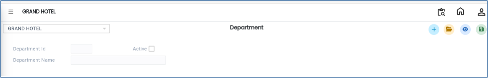
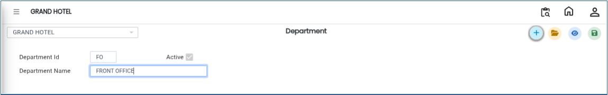

# Department

The **Department** master is used to create and manage different departments. Departments help in organising internal operations such as service handling, billing, kitchen coordination, and other functional areas required for banquet management.

## **Steps to Create a Department**

Step 1: Log in to the system and navigate to the **Banquet Module**.

1. Click on the **Masters** menu.
2. Select **Department** from the available options.

Step 2: After selecting **Department**, the system will open the Department master screen.

<figure><figcaption></figcaption></figure>

Step 3: Click on the **New** button.

1. A new entry form will appear on the screen.
2. Enter the required details:
   * **Department ID**
   * **Department Name**

Ensure that the entered details are correct and clearly defined for proper internal classification.

<figure><figcaption></figcaption></figure>

Step 4: After entering the required details, click on the **Save** button.

* The system will save the Department successfully.

<figure><figcaption></figcaption></figure>
