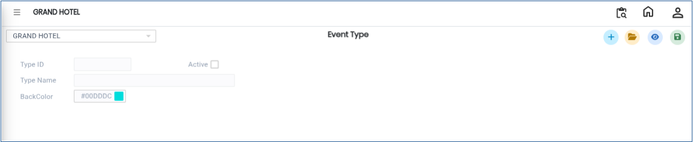
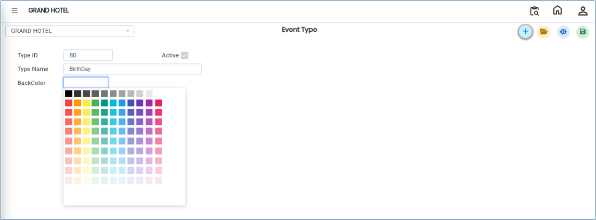

# Event Type

The **Event Type** option in the Banquet Module is used to create and manage different event types within the system. This screen helps users organise events by maintaining Type IDs, Type Names, and Group Short Names.

## Steps to Create a Event Type

Step 1: Login to the application and navigate to the **Banquet Module**.

1. Click on **Masters**.
2. Select **Event Type**.

* After selecting the Event Type option, the **Event Type Details** screen will be displayed.

<figure><figcaption></figcaption></figure>

Step 2: Click on **Open** button.

1. The screen displays the list of existing Event Types.
2. Users can review previously created Event Type records and their details.

Step 3: Click on the **New** button.

1. Enter the required details in the respective fields:
   * **Type ID** – Enter a unique ID for the Event Type.
   * **Type Name** – Enter the name of the Event Type.
   * **Group Short Name** – Enter a short name or abbreviation for the Event Type.
2. Verify that all entered details are correct before saving.

<figure><figcaption></figcaption></figure>

Step 4: After entering all the required information, click on the **Save** button.

1. The Event Type details will be saved successfully.

<figure><figcaption></figcaption></figure>
