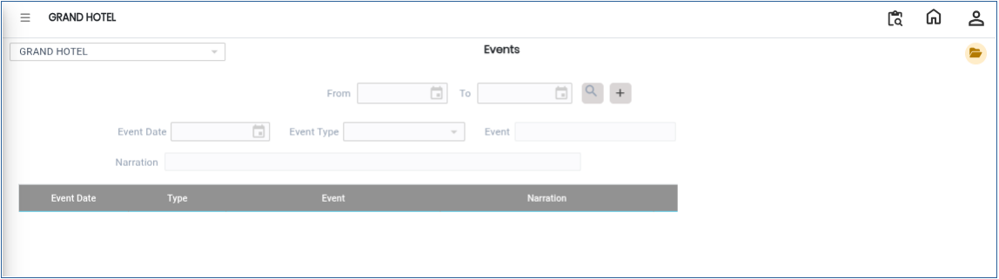
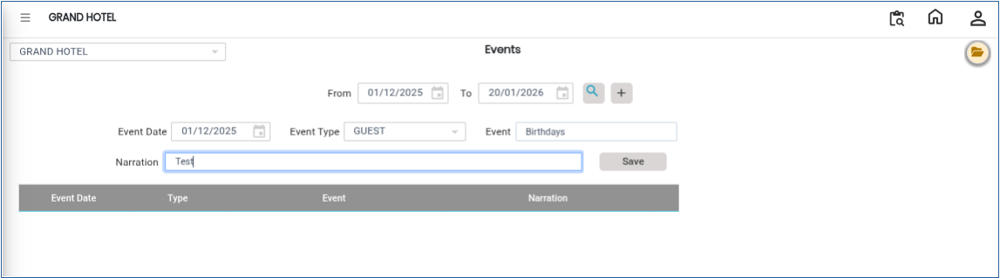
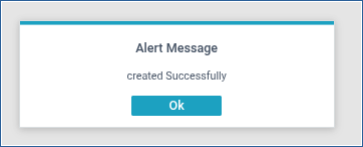

# Events

The **Events** option in the Banquet Module is used to create and manage event details within the system. This screen allows users to maintain event information such as Event Date and Event Type.

## Steps to Create a Event

Step 1: Login to the application and navigate to the **Banquet Module**.

1. Click on **Masters**.
2. Select **Events**.

* After selecting the Events option, the **Events Details** screen will be displayed.

<figure><figcaption></figcaption></figure>

Step 2: Click on the **Open** button.

1. Enter the required details in the respective fields:
   * **Event Date** – Select or enter the date of the event.
   * **Event Type** – Select the appropriate Event Type from the available list.
2. Verify that all entered details are correct before saving.

<figure><figcaption></figcaption></figure>

Step 3: After entering all the required information, click on the **Save** button.

1. The Event details will be saved successfully.

<figure><figcaption></figcaption></figure>
