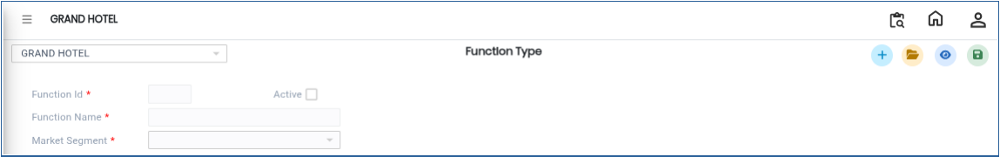
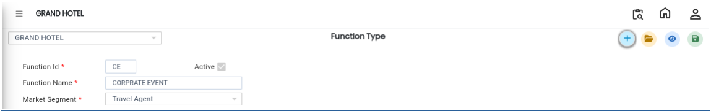

# Function Type

The **Function Type** master is used to define and manage different types of banquet functions or events. This helps categorise events such as weddings, conferences, parties, meetings, and other banquet activities. It also allows linking each function type with a market segment for better reporting and analysis.

## **Steps to Create a Function Type**

Step 1: Log in to the system and navigate to the **Banquet Module**.

1. Click on the **Masters** menu.
2. Select **Function Type** from the available options.

Step 2: After selecting **Function Type**, the system will open the Function Type master screen.

<figure><figcaption></figcaption></figure>

Step 3: Click on the **New** button.

1. A new entry form will appear on the screen.
2. Enter the required details:
   * **Function ID**
   * **Function Name**
   * **Market Segment**

Ensure that all details are entered correctly for proper classification and reporting.

<figure><figcaption></figcaption></figure>

Step 4:After entering the required details, click on the **Save** button.

* The system will save the Function Type successfully.

<figure><figcaption></figcaption></figure>
