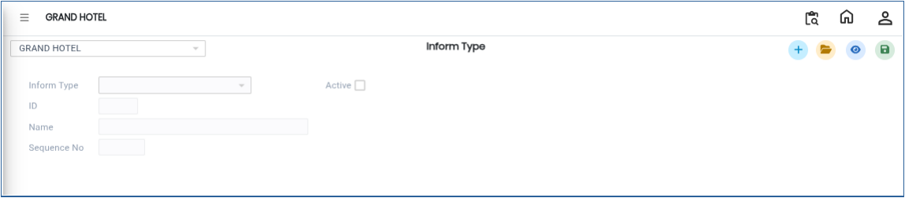
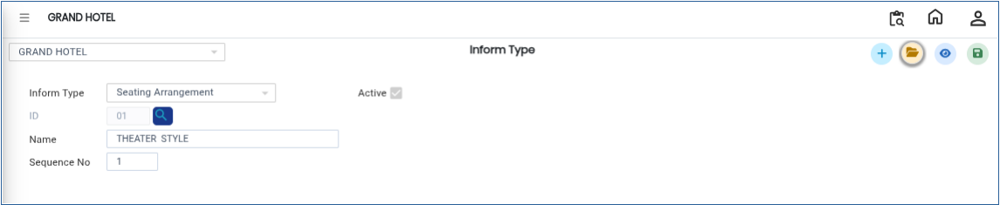

# Inform Type

The **Inform Type** option in the Banquet Module is used to create and manage different types of information categories used within the system. This screen helps users maintain and organise Inform Types efficiently.

## Steps to Create a Inform Type

Step 1: Login to the application and navigate to the **Banquet Module**.

1. Click on **Masters**.
2. Select **Inform Type**.

* After selecting the Inform Type option, the **Inform Type Details** screen will be displayed.

<figure><figcaption></figcaption></figure>

Step 2: Click on the **Open** button.

1. The screen displays the list of existing Inform Types.
2. Users can review previously created Inform Type records and their details.

Step 3: Click on the **New** button.

1. Select or enter the required **Inform Type** from the available options.

<figure><figcaption></figcaption></figure>

2. Verify that the selected Inform Type is correct.

<figure><figcaption></figcaption></figure>

Step 4: After selecting the required Inform Type, click on the **Save** button.

1. The Inform Type details will be saved successfully.

<figure><figcaption></figcaption></figure>
