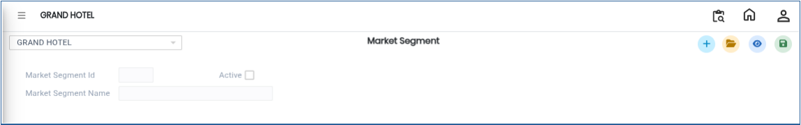
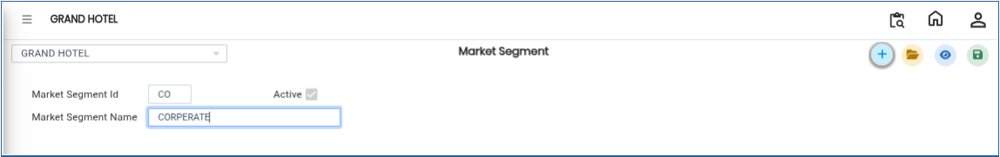

# Market Segment

The **Market Segment** master is used to define and manage different categories of customers or business segments. This helps in analysing banquet business based on customer type such as corporate, individual, travel agents, or other defined segments. It is mainly used for reporting, analysis, and business performance tracking.

## **Steps to Create a Market Segment**

Step 1: Log in to the system and navigate to the **Banquet Module**.

1. Click on the **Masters** menu.
2. Select **Market Segment** from the available options.

Step 2: After selecting **Market Segment**, the system will open the Market Segment master screen.

<figure><figcaption></figcaption></figure>

Step 3: Click on the **New** button.

1. A new entry form will appear on the screen.
2. Enter the required details:
   * **Market Segment ID**
   * **Market Segment Name**

Ensure that the details are entered correctly for proper classification and reporting.

<figure><figcaption></figcaption></figure>

Step 4: After entering the required details, click on the **Save** button.

* The system will save the Market Segment successfully.

<figure><figcaption></figcaption></figure>
