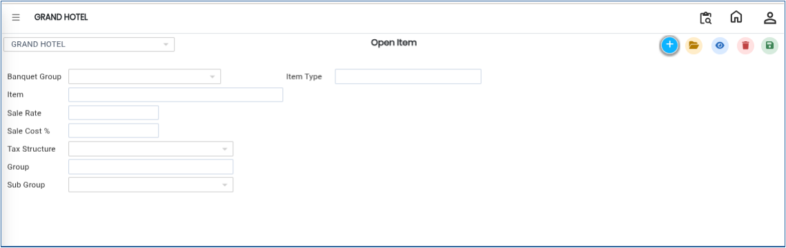
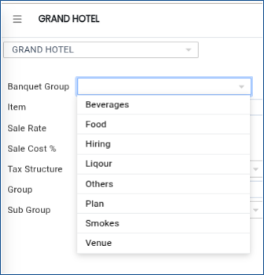
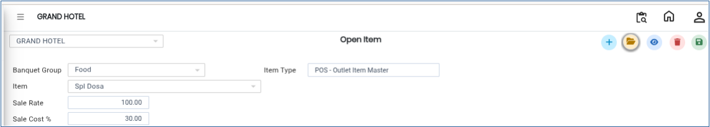
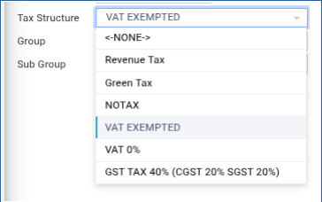
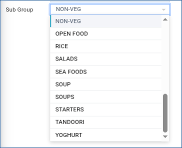
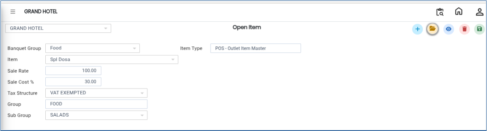

# Open Item

The **Open Item** master is used to create and manage flexible banquet items where details such as item name, sale rate, sale cost, tax structure, and subgroup can be defined. These items are linked to banquet groups and are used for billing and operational purposes.

### **Steps to Create an Open Item**

Step 1: Log in to the system and navigate to the **Banquet Module**.

1. Click on the **Masters** menu.
2. Select **Open Item** from the available options.

Step 2: After selecting **Open Item**, the system will open the Open Item master screen.

<figure><figcaption></figcaption></figure>

Step 3: Click on the **Banquet Group** option.

1. Select the required group for the open item.

* This helps classify the item under a specific banquet category.

<figure><figcaption></figcaption></figure>

Step 4: After selecting the banquet group, enter the required item details:

* **Item Name**
* **Sale Rate**
* **Sale Cost**

Ensure all values are entered correctly for accurate billing and reporting.

<figure><figcaption></figcaption></figure>

Step 5: Click on the **Tax Structure** option.

1. Select the applicable tax structure from the available list.

* This ensures correct tax calculation during billing.

<figure><figcaption></figcaption></figure>

Step 6: Click on the **Sub Group** option.

1. Choose the appropriate sub group from the list.

* This helps further categorize the item for reporting and management purposes.

<figure><figcaption></figcaption></figure>

Step 7: After completing all required fields and selections, click on the **Save** button.

* The system will save the Open Item successfully.

<figure><figcaption></figcaption></figure>

<figure><figcaption></figcaption></figure>
