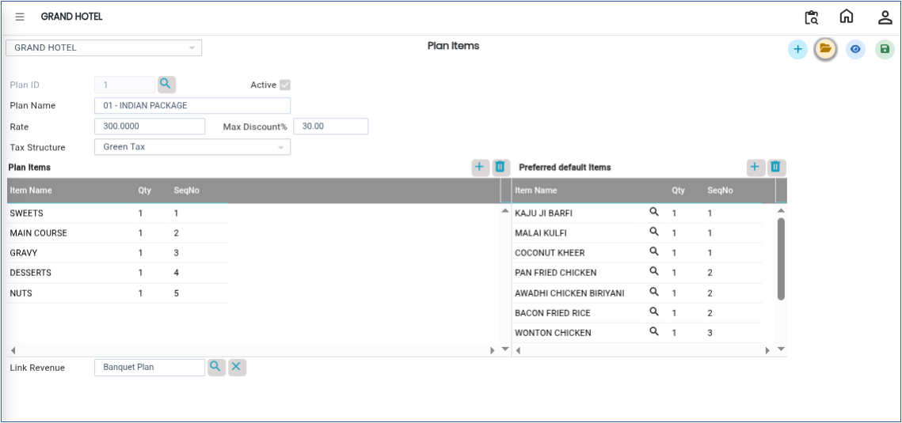
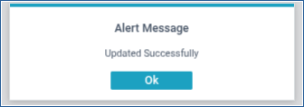

# Plan Item

The **Plan Items** master is used to create and manage banquet plans. Users can define plan details such as plan ID, plan name, rate, tax structure, and revenue group mapping. These plans are used for banquet booking, billing, and financial management.

## **Steps to Create Plan Items**

Step 1: Log in to the system and navigate to the **Banquet Module**.

1. Click on the **Masters** menu.
2. Select **Plan Items** from the available options.

Step 2: After selecting **Plan Items**, the system will open the Plan Items master screen.

<figure><figcaption></figcaption></figure>

Step 3: Click on the **New** button.

1. A new entry screen will appear.
2. Enter the required details such as:
   * **Plan ID**
   * **Plan Name**
   * **Rate**
   * **Tax Structure**

Ensure that all mandatory fields are entered correctly before proceeding.

Step 4: After entering the plan details, select or link the appropriate **Revenue Group**.

* The revenue group mapping helps maintain accurate accounting and financial tracking for the plan item.

<figure><figcaption></figcaption></figure>

Step 5: Once all required information has been entered and the revenue group has been linked, click on the **Save** button.

* The system will save the Plan Item successfully.

<figure><figcaption></figcaption></figure>
