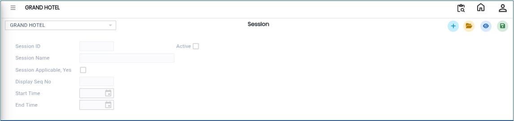
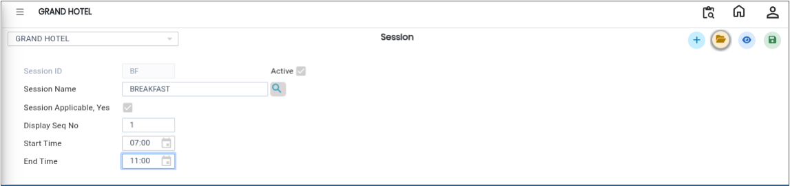

# Session

The **Session** master is used to define and manage time-based sessions. Sessions help categorize banquet activities based on specific time intervals such as breakfast, lunch, dinner, or other custom time slots. These sessions are used for scheduling, reporting, and operational planning.

## **Steps to Create a Session**

Step 1: Log in to the system and navigate to the **Banquet Module**.

1. Click on the **Masters** menu.
2. Select **Session** from the available options.

Step 2: After selecting **Session**, the system will open the Session master screen.

<figure><figcaption></figcaption></figure>

Step 3: Click on the **New** button.

1. A new entry form will appear.
2. Enter the required details:
   * **Session ID**
   * **Session Name**
   * **Display Sequence Number**
   * **Start Time**
   * **End Time**

Ensure that all fields are entered correctly to define the session timing properly.

<figure><figcaption></figcaption></figure>

Step 4: After entering all required details, click on the **Save** button.

* The system will save the Session successfully.

<figure><figcaption></figcaption></figure>
