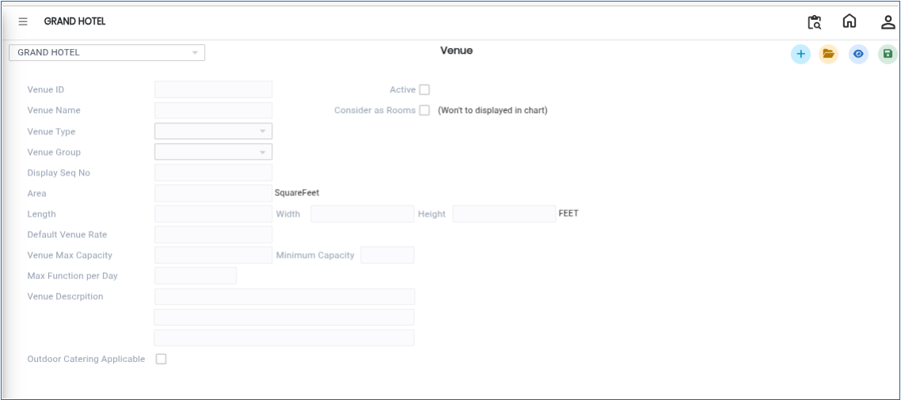
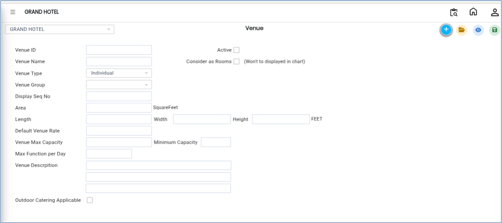
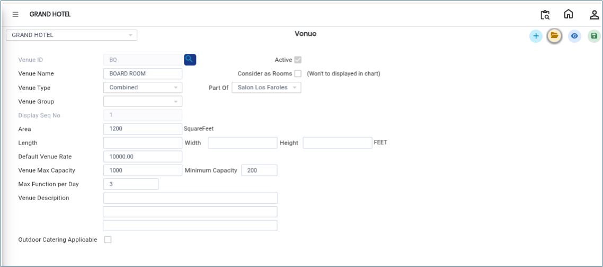

# Venue

The **Venue** master is used to create and manage banquet venues such as halls, rooms, or event spaces. This setup helps define venue details, categorise venue types, and manage venue availability for banquet operations and bookings.

## **Steps to Create a Venue**

Step 1: Log in to the system and navigate to the **Banquet Module**.

1. Click on the **Masters** menu.
2. Select **Venue** from the available options.

Step 2: After selecting **Venue**, the system will open the Venue master screen.

<figure><figcaption></figcaption></figure>

Step 3: Click on the **New** button.

* A new entry form will appear on the screen.

<figure><figcaption></figcaption></figure>

Step 4: Enter the required venue information such as **Venue ID, Venue Name, Venue Type** and Other relevant details&#x20;

* Ensure all details are entered correctly for proper configuration and usage.

<figure><figcaption></figcaption></figure>

Step 5: After entering all required information, click on the **Save** button.

* The system will save the Venue successfully.

<figure><figcaption></figcaption></figure>
