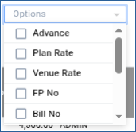

# Banquet Reservation List

The **Banquet Reservation List** feature helps users manage reservation records efficiently by displaying all banquet bookings in a structured report format.

## Steps to Create the Banquet Reservation List

Step 1: Navigate to the **Banquet** module and select **Queries** menu.

1. Click on **Banquet Reservation List**.

After selecting the menu, the **Banquet Reservation List** screen will be displayed.

<figure><figcaption></figcaption></figure>

Step 2: On the **Banquet Reservation List** screen, click the **Display** button.

1. The system will display the complete list of banquet reservations below the screen.

* This list contains all reservation details available in the system.

<figure><figcaption></figcaption></figure>

Step 3: Click the **Options** button.

1. The system will open the filtering options window.

You can filter the reservation list based on the following options:

* **Advance**
* **Plan Rate**
* **Venue Rate**
* Other available reservation criteria

<figure><figcaption></figcaption></figure>

These filters help users view specific reservation records according to their requirements.

Step 4: After applying the required filters, the filtered reservation list will be displayed on the screen.

1. Click on one of the following buttons to generate the report:

* **Print** – To print the reservation report.
* **Excel** – To export the reservation report in Excel format.

The report will be generated in the selected format.

<figure><figcaption></figcaption></figure>
