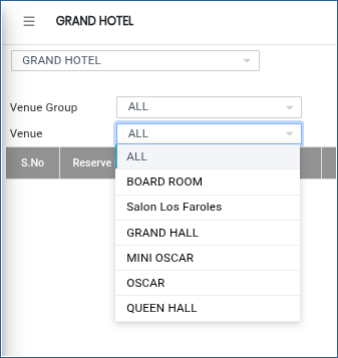
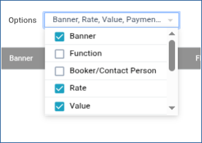
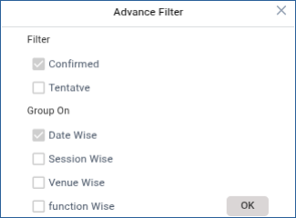
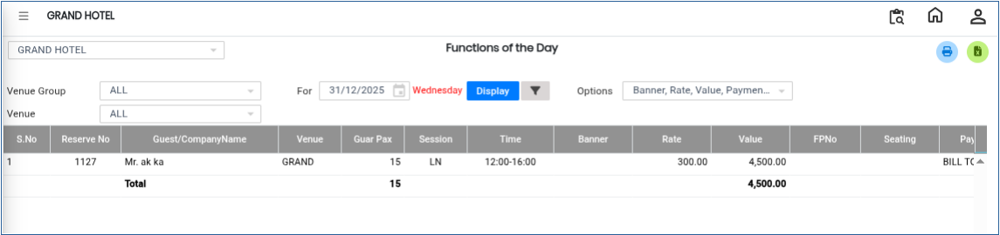

# Functions Of The Day

The **Functions of the Day** feature is used to view daily venue booking details and generate reports based on selected filters. This option helps users monitor scheduled functions, venue reservations, and booking details efficiently.

## Steps to View Functions of the Day

Step 1: Navigate to the **Banquet** module and select **Queries** menu.

1. Click on **Venue Booking**.

After selecting the menu, the **Functions of the Day** screen will be displayed.

<figure><figcaption></figcaption></figure>

Step 2: On the **Functions of the Day** screen, click the **Venue** option.

1. The venue selection screen will appear.

* Here, users can select the required venue to view booking details.

<figure><figcaption></figcaption></figure>

Step 3: Click on the **Options** button.

1. The system will display various filtering options.

* Users can filter the booking details based on the available criteria to view specific function records.

<figure><figcaption></figcaption></figure>

Step 4: Click on the **Advance Filter** option.

1. Additional filtering options will be displayed.

* The Advance Filter helps users perform a more detailed search by applying multiple conditions to the booking records.

<figure><figcaption></figcaption></figure>

Step 5: After selecting the required filters, click the **Display** button.

1. The system will display the filtered list of functions and venue booking details.

* Users can review all the relevant booking information on the screen.

<figure><figcaption></figcaption></figure>

Step 6: Once the booking details are displayed, the report screen will appear.

1. Click one of the following buttons to generate the report:

* **Print** – To print the report.
* **Excel** – To export the report in Excel format.

The report will be generated in the selected format.

<figure><figcaption></figcaption></figure>
