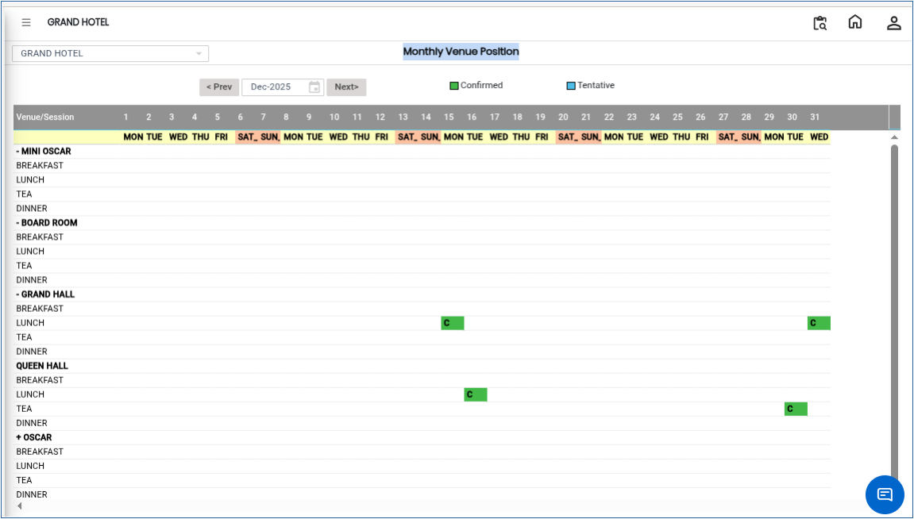

# Monthly Venue Position

The **Monthly Venue Position** report is used to view the status of all venues for an entire month. It shows both **reservations** and **blocked dates** for each venue, helping users understand venue availability and plan bookings in advance.

## Steps to View Monthly Venue Position

Step 1: Navigate to the **Banquet** module and select **Queries** menu.

1. Click on **Monthly Venue Position**.

* This will open the Monthly Venue Position report screen.

Step 2: The system will display the **reservations** and **blocked entries** for each venue.

1. All venues will be listed with their booking status for the selected month.

<figure><figcaption></figcaption></figure>
