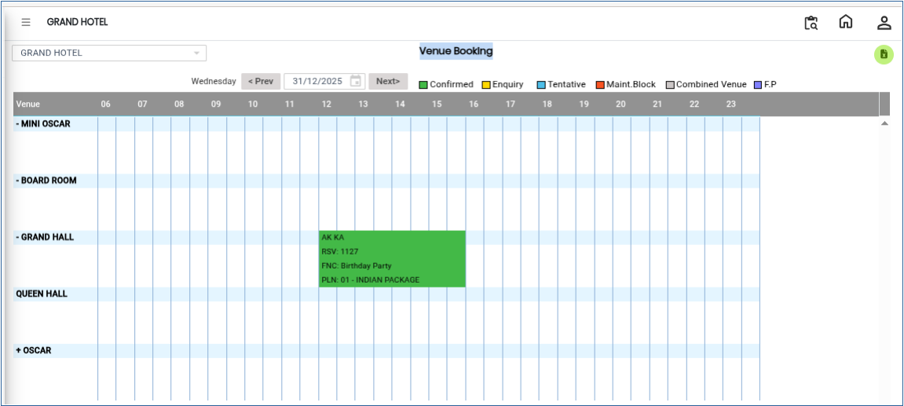

# Venue Booking

The **Venue Booking** feature is used to view all reservations and blocked slots for different venues on a selected day. This report helps users check the availability of venues and manage bookings efficiently.

## Steps to Access Venue Booking Report

Step 1: Navigate to the **Banquet** module and select **Queries** menu.

1. Click on **Venue Booking**.

* This will open the Venue Booking report screen.

Step 2: The system will display all **reservations** and **blocked entries** for the selected date.

1. Each venue will show its booking status for the day.
2. You can review the details such as booked slots, blocked periods, and availability.

<figure><figcaption></figcaption></figure>
