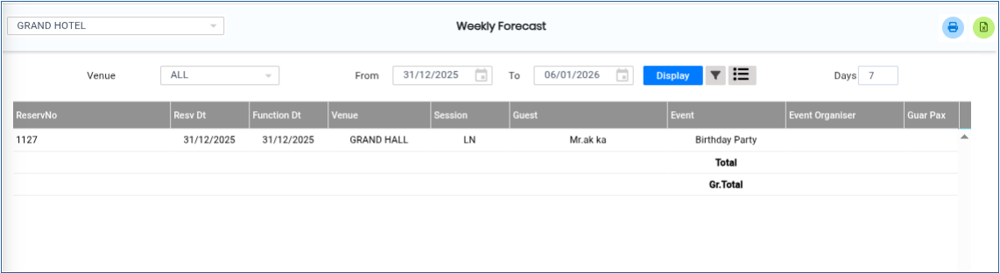

# Weekly Forecast

The **Weekly Forecast** feature is used to view upcoming venue bookings and scheduled functions for the week. It helps users analyse future reservations, apply filters, and generate reports for better planning and management.

## Steps to View the Weekly Forecast

Step 1: Navigate to the **Banquet** module and select **Queries** menu.

1. Click on **Weekly Forecast**.

* After selecting the menu, the **Weekly Forecast** screen will be displayed.

<figure><figcaption></figcaption></figure>

Step 2: On the **Weekly Forecast** screen, click the **Venue** option.

1. The venue selection screen will appear.

* Users can select the required venue to view the weekly booking forecast.

<figure><figcaption></figcaption></figure>

Step 3: Click on the **Advanced Search** option.

1. The advanced search screen will be displayed.

* This option allows users to perform a detailed search by specifying additional search criteria for the weekly forecast report.

<figure><figcaption></figcaption></figure>

Step 4: Click on the **Options** button.

1. Various filter options will be displayed on the screen.

* Users can apply the required filters to narrow down the forecast details based on their requirements.

<figure><figcaption></figcaption></figure>

Step 5: After selecting the required venue and filters, click the **Display** button.

1. The system will display the weekly forecast details below the screen.

* The displayed information will include the scheduled bookings and function details for the selected period.

<figure><figcaption></figcaption></figure>

Step 6: Once the forecast details are displayed, the report screen will appear.

1. Click one of the following buttons to generate the report:

* **Print** – To print the weekly forecast report.
* **Excel** – To export the report in Excel format.

The report will be generated in the selected format.

<figure><figcaption></figcaption></figure>
