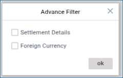
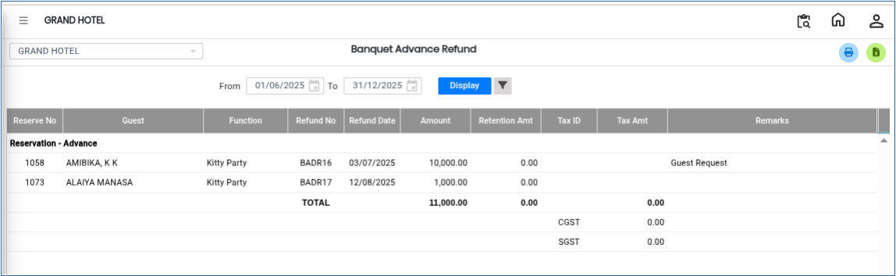

# Banquet Advance Refund

The **Banquet Advance Refund** report is used to view details of advance amounts that have been refunded for banquet bookings.

## Steps to view Banquet Advance Refund

Step 1: Go to the **Reports** menu in the **Banquet** module.

1. Click on **Banquet Advance Refund**.

Step 2: After opening the report, select the required date range.

<figure><figcaption></figcaption></figure>

Step 3: Click on the **Advanced Search** button available on the screen.

1. Select the required search criteria in the Advanced Search fields.

<figure><figcaption></figcaption></figure>

Step 4: After entering the details, click on the **Display** button.

* The system will display Banquet Advance Refund report.

<figure><figcaption></figcaption></figure>
