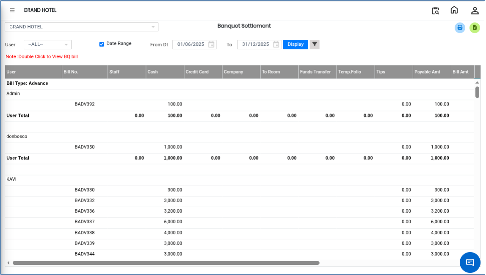

# Banquet Settlement

**Banquet Settlement** is a report feature used to view and manage settlement details related to banquet bookings. It helps in tracking financial transactions and can be filtered based on users or advanced search options for better analysis.

## Steps to View Banquet Settlement&#x20;

Step 1: Go to the **Reports** menu in the **Banquet** module.

1. Click on **Banquet Settlement**.

Step 2: After opening the Banquet Settlement page, you will see the list of all settlement records.

* This page displays settlement details such as bookings, amounts, and related information.

<figure><figcaption></figcaption></figure>

Step 3: To filter records based on a specific user:

1. Click on the **User** filter option.
2. Select the required user from the drop down list.
3. The system will display only the settlement records associated with the selected user.

<figure><figcaption></figcaption></figure>

Step 4: Click on the **Advanced Search** option available on the screen.

1. Select the required filter criteria as needed.

<figure><figcaption></figcaption></figure>

Step 5: After applying filters in Advanced Search, click on the **Display** button.

* The system will display Banquet Settlement report on the screen.

<figure><figcaption></figcaption></figure>
