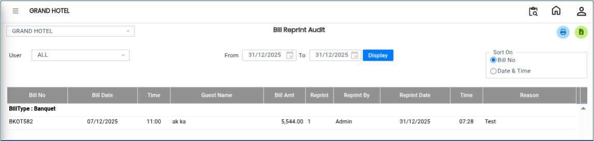

# Bill Reprint Audit

The **Bill Reprint Audit Report** is used to track all bill reprints performed in the system. This report helps management and auditors monitor reprinted bills, identify the user who performed the reprint, and maintain proper audit control.

## **Steps to View Bill Reprint Audit Report**

Step 1: Log in to the system and navigate to the **Banquet Module**.

1. Click on the **Reports** menu.
2. Select **Bill Reprint Audit** from the list of available reports.

Step 2: After selecting **Bill Reprint Audit**, the system will open the report page.

* By default, the system displays the report based on a **predefined day/date range**.
* This view shows all bill reprint activities recorded within the selected period.

<figure><figcaption></figcaption></figure>

Step 3: Click on the **User** option.

* Select the required user from the list to filter the report based on a specific user.

<figure><figcaption></figcaption></figure>

Step 4: After selecting the user and verifying the date range, click on the **Display** button.

* The system will generate and display the **Bill Reprint Audit Report**.

<figure><figcaption></figcaption></figure>
