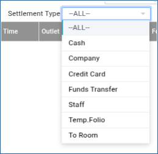
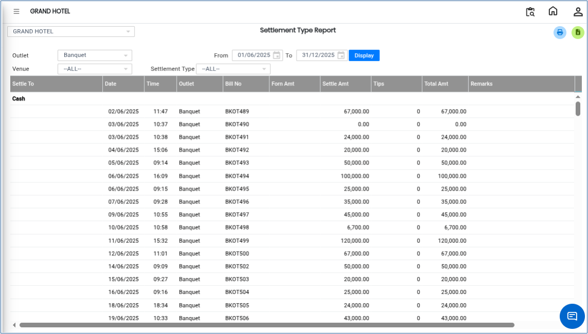

# Settlement type Report

The **Settlement Type Report** is used to view all transactions based on different settlement methods such as cash, card, bank transfer, or other payment types. This report helps in analysing how payments were received for banquet bookings within a selected date range.

## **Steps to View Settlement Type Report**

Step 1: Log in to the system and navigate to the **Banquet Module**.

* Click on the **Reports** menu.
* Select **Settlement Type Report** from the list of available reports.

Step 2: After selecting **Settlement Type Report**, the system will open the report page.

* By default, the system displays the report based on a **predefined day/date range**.
* This view shows settlement details for the selected default period.

<figure><figcaption></figcaption></figure>

Step 3: Click on the **Settlement Type** option available on the screen.

* A list of available settlement methods will be displayed.
* Select the required settlement type (for example: Cash, Card, Online Transfer, etc.).

<figure><figcaption></figcaption></figure>

Step 4: Choose the required **From Date** and **To Date**.

* Ensure the correct date range is selected to get accurate report results.

Step 5: After selecting the settlement type and date range, click on the **Display** button.

* The system will generate the **Settlement Type Report** based on the selected filters.

<figure><figcaption></figcaption></figure>
