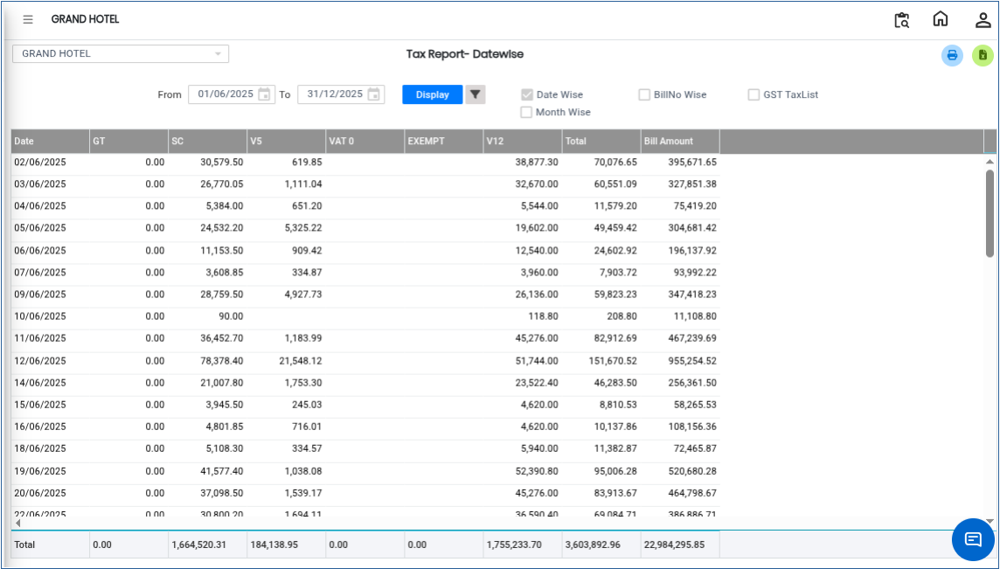

# Tax Report

The **Tax Report** is used to view tax details of transactions within a selected date range. It helps in analysing tax amounts collected, categorised tax structures, and overall tax summary for financial reporting and audit purposes.

## **Steps to View Tax Report**

Step 1: Log in to the system and go to the **Banquet Module**.

1. Click on the **Reports** menu.
2. Select **Tax Report** from the list of available reports.

Step 2: After selecting **Tax Report**, the system will open the report page.

* By default, the system displays the **Tax Report based on a selected day/date range**.
* This view shows tax details for transactions within the default period.

<figure><figcaption></figcaption></figure>

Step 3: Click on the **Advanced Search** option.

* The system will display additional filter options for refining the report.

<figure><figcaption></figcaption></figure>

Step 4: In the Advanced Search window, click on the **Search** button.

* Choose the required **Tax Structure** from the list.
* After selecting, click on the **OK** button to confirm your selection.

<figure><figcaption></figcaption></figure>

Step 5: After applying the required filters, click on the **Display** button.

* The system will generate and show the **Tax Report** based on the selected tax structure and date range.

<figure><figcaption></figcaption></figure>
