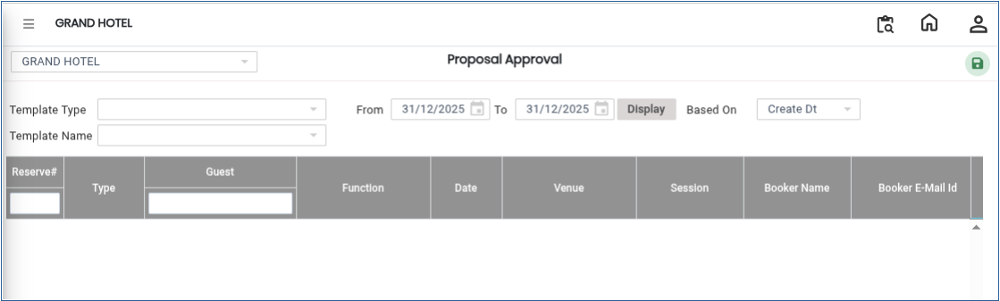
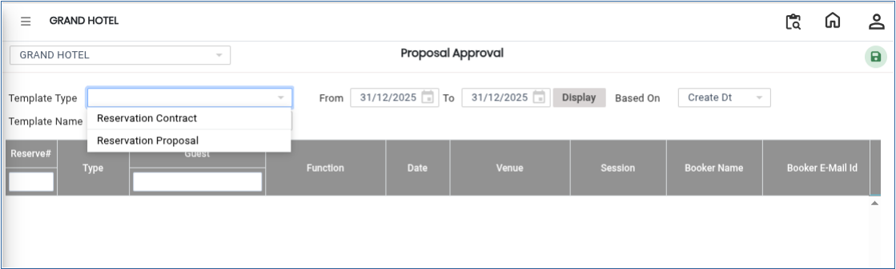
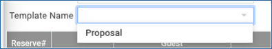
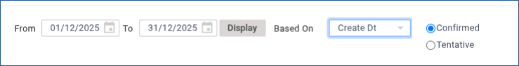

# Banquet Approval

The **Banquet Approval** feature is used to review and approve banquet reservations or event bookings. Users can filter reservations based on template type, template name, date range, and confirmation status before approving the required booking.

## Steps to Create a Banquet Approval

Step 1: Navigate to the **Banquet** module and select **Transaction**.

1. Click on **Banquet Approval**.

Step 2: After selecting **Banquet Approval**, the approval screen will be displayed.

1. The screen contains search options, filters, and approval details required for processing banquet reservations.

<figure><figcaption></figcaption></figure>

Step 3: Click on the **Template Type** drop-down field.

1. Choose the required template type from the available list.

* The selected template type will be applied to filter the banquet reservations.

<figure><figcaption></figcaption></figure>

Step 4: Click on the **Template Name** drop-down field.

1. Select the required template name from the available options.

* This helps identify the specific banquet or event template for approval.

<figure><figcaption></figcaption></figure>

Step 5: Choose the required **From Date** and **To Date** range.

1. Select the search basis:
   * **Based On Create Date**, or
   * **Based On Function Date**
2. Select the required **Confirmation Status** from the available options.

* The system will display reservations based on the selected criteria.

<figure><figcaption></figcaption></figure>

Step 6: From the displayed reservation list, select the required **Guest Name**.

1. Verify the reservation details carefully.
2. Click on the **Approve** button.

* The selected reservation will be marked for approval.

<figure><figcaption></figcaption></figure>

Step 7: After clicking the **Approve** button, click the **Save** button.

1. The banquet reservation will be successfully approved.
