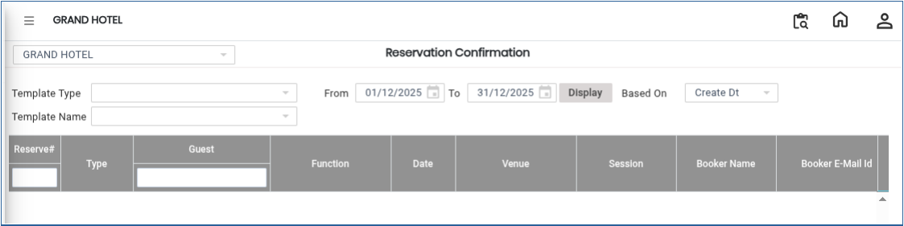
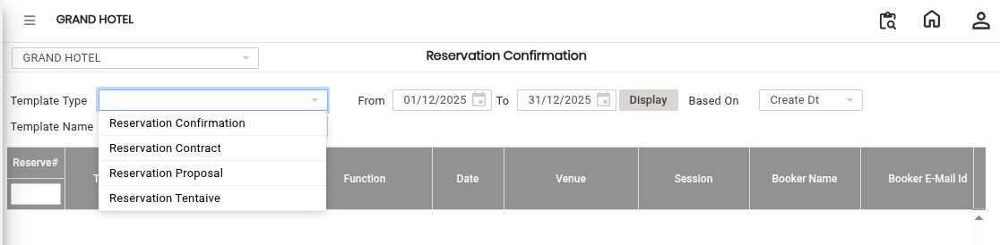
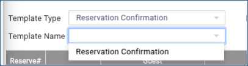
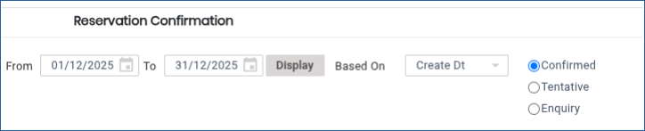
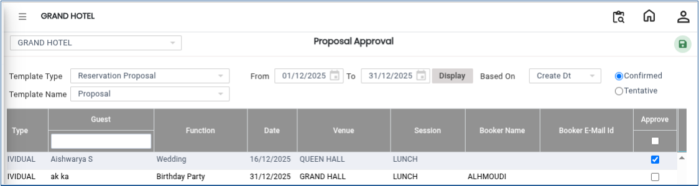
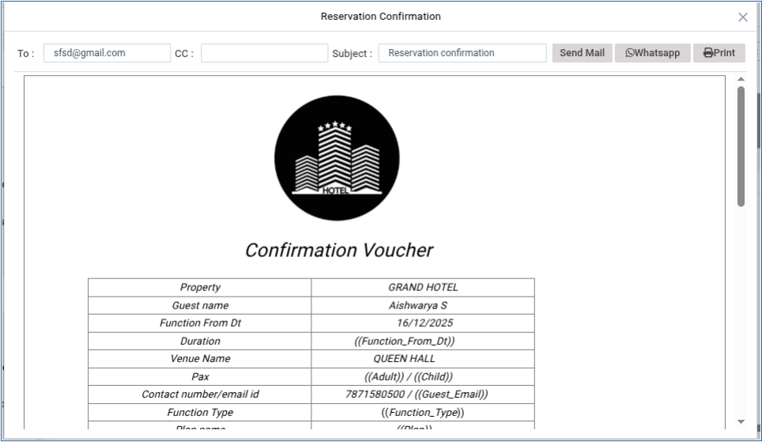

# Banquet Emails

The **Banquet Emails** feature is used to view reservation confirmations and communicate with guests through email, WhatsApp, or printed confirmations. Users can filter banquet reservations using template type, template name, date range, and confirmation status before sending the required communication.

## Steps to Create Banquet Emails

Step 1: Navigate to the **Banquet** module and select **Transaction**.

1. Click on **Banquet Emails**.

Step 2: After selecting **Banquet Emails**, the screen will be displayed.

1. The screen contains search filters and reservation details required for sending confirmations.

<figure><figcaption></figcaption></figure>

Step 3: Click on the **Template Type** drop-down field.

1. Choose the required template type from the available list.

* The selected template type will help filter the reservation records.

<figure><figcaption></figcaption></figure>

Step 4: Click on the **Template Name** drop-down field.

1. Select the required template name from the available options.

* This helps identify the appropriate banquet or reservation template.

<figure><figcaption></figcaption></figure>

Step 5: Choose the required **From Date** and **To Date** range.

1. Select the search basis:
   * **Based On Create Date**, or
   * **Based On Function Date**
2. Select the required **Confirmation Status**.

* The system will display reservations based on the selected criteria.

<figure><figcaption></figcaption></figure>

Step 6: From the displayed reservation list, locate the required **Guest Name**.

1. Double-click on the selected guest name.

* The reservation confirmation screen for the selected guest will open.

<figure><figcaption></figcaption></figure>

Step 7: From the reservation confirmation screen, users can perform the following actions:

* View the reservation confirmation details.
* Send the confirmation through **Email.**
* Send the confirmation through **WhatsApp.**
* Print the reservation confirmation.

Select the required option to complete the communication process.

<figure><figcaption></figcaption></figure>
