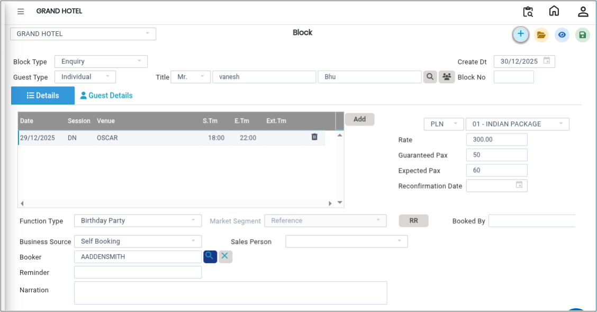

# Block

The **Block** feature is used to temporarily reserve or block a venue for specific purposes such as a **Wait List** or **Maintenance Block**. This helps prevent the venue from being booked for other reservations during the selected date and session.

## Steps to Create a Venue Block

Step 1: Go to the **Banquet module** in the system dashboard.

1. Click on **Block** option available under the **Transactions** Menu.

Step 2: Click **New** button , a form will open.

* Choose the **Block Type** as:
  * _Wait List Block_ (for tentative bookings), or
  * _Maintenance Block_ (for blocking venue due to maintenance or non-availability)
* Fill in the required details carefully:
  * **Guest Name** – Name of the guest or event organiser
  * **Date** – Scheduled date of the block
  * **Session** – Time slot (e.g., Morning / Evening / Full Day)
  * **Venue** – Select the required venue/location
  * **Plan** – Applicable plan or package details
  * **Guaranteed Pax** – Confirmed number of participants
  * **Expected Pax** – Estimated number of participants
  * **Function Type** – Type of event (e.g., Wedding, Meeting, Conference)
  * **Business Source** – Source of booking (e.g., Direct, Agent, Corporate)
  * **Market Segment** – Category of customer (e.g., Corporate, Leisure, Wedding)

Ensure all information is entered accurately to avoid booking conflicts.

<figure><figcaption></figcaption></figure>

Step 3: After verifying all entered details, click on the **Save** button..png>)

* The system will create and register the Block successfully.
