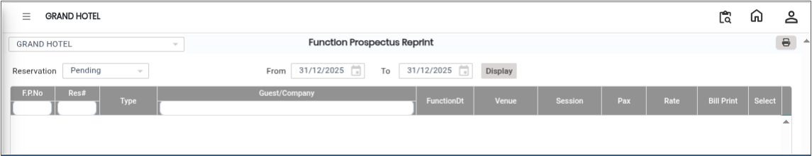
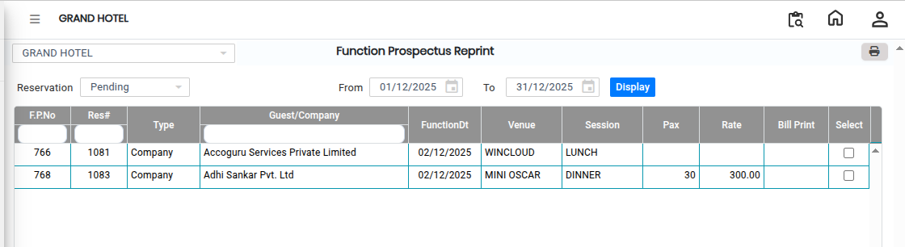
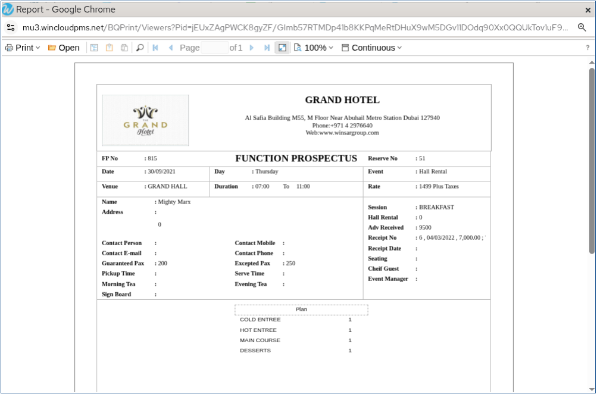

# Function Prospectus Reprint

The **Function Prospectus Reprint** feature is used to reprint an existing Function Prospectus for a selected reservation. This option is helpful when an additional copy of the prospectus is required for guest reference, internal records, or event management purposes.

## Steps to Reprint a Function Prospectus

Step 1: Navigate to the **Banquet** module and select **Transaction**..

1. Click on **Function Prospectus**.

* The Function Prospectus screen will open.

<figure><figcaption></figcaption></figure>

Step 2: Click the **Display** button.

1. The system will display the list of available reservations.
2. Select the reservation for which the Function Prospectus needs to be reprinted.

* Ensure the correct reservation is selected before proceeding.

<figure><figcaption></figcaption></figure>

Step 3: After selecting the reservation, click on the **Print** button.

1. The Function Prospectus will be generated and displayed for printing.
2. Proceed with the print option to obtain the reprint copy of the Function Prospectus.

<figure><figcaption></figcaption></figure>
