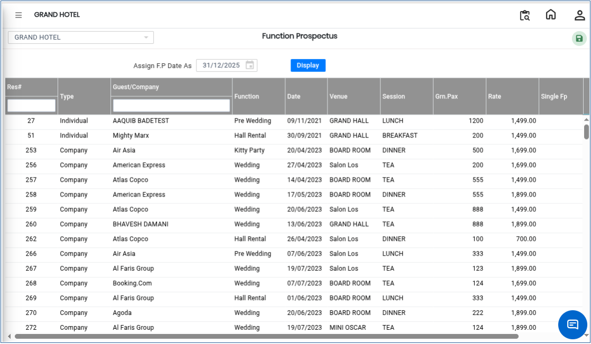
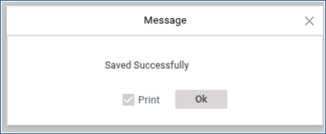
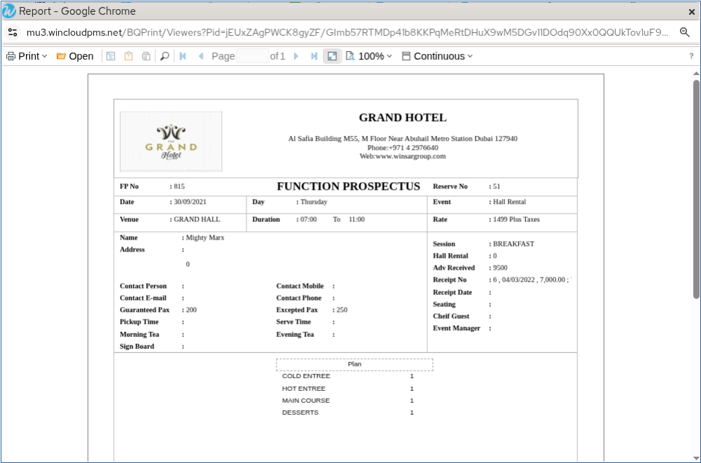

# Function Prospectus

The **Function Prospectus** feature is used to generate and print a detailed prospectus for a selected reservation or function booking. This document contains the necessary function and reservation details for reference and communication purposes.

## Steps to Create a Function Prospectus

Step 1: Navigate to the **Banquet** module and select **Transaction**.

1. Click on **Function Prospectus**.

* The Function Prospectus screen will open.

Step 2: Click the **Display** button.

1. The system will display the list of available reservations.
2. Select the reservation for which the Function Prospectus needs to be created.

* Ensure the correct reservation is selected before proceeding.

<figure><figcaption></figcaption></figure>

Step 3: After selecting the reservation, click the **Save** button..png>)

1. Click **OK** to confirm the process.

<figure><figcaption></figcaption></figure>

* The Function Prospectus will be generated successfully.
* The prospectus can now be viewed and printed as required.

<figure><figcaption></figcaption></figure>
