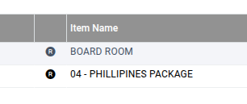

# Kot/Charges

The **KOT / Charges** feature is used to generate Kitchen Order Tickets (KOT) and apply charges against a reservation. This process allows users to select reservation items, raise KOTs, and add applicable charges for food, beverages, or other services related to the reservation.

## Steps to Create KOT / Charges

Step 1: Navigate to the **Banquet** module and select **Transaction**.

1. Click on **KOT / Charges**.

* The KOT / Charges screen will open.

<figure><figcaption></figcaption></figure>

Step 2: In the **Category** field, select **KOT**.

1. Click on the **Reserve No** field.
2. Select the required reservation number to generate the KOT.

<figure><figcaption></figcaption></figure>

Step 3: After clicking the reservation number field, the list of reservations will be displayed.

1. Select the required reservation from the list.

Ensure the correct reservation is selected before proceeding.

<figure><figcaption></figcaption></figure>

Step 4: Click on the **R** symbol to select the required items for the reservation.

<figure><figcaption></figcaption></figure>

1. Choose the items that need to be included in the KOT.
2. Verify the selected items carefully.

<figure><figcaption></figcaption></figure>

Step 5: After selecting the items, click the **Save** button.

1. The KOT will be generated successfully.

Step 6: In the **Category** field, select **Charges**.

1. Click on the **Reservation No** field.
2. Select the required reservation from the displayed list.

Step 7: The reserved items associated with the selected reservation will be displayed.

1. Select the required items for which charges need to be applied.

* Verify all selected items before saving.

<figure><figcaption></figcaption></figure>

Step 8: After selecting the required items, click the **Save** button.

<figure><figcaption></figcaption></figure>

1. The charges will be created successfully for the selected reservation.

<figure><figcaption></figcaption></figure>
