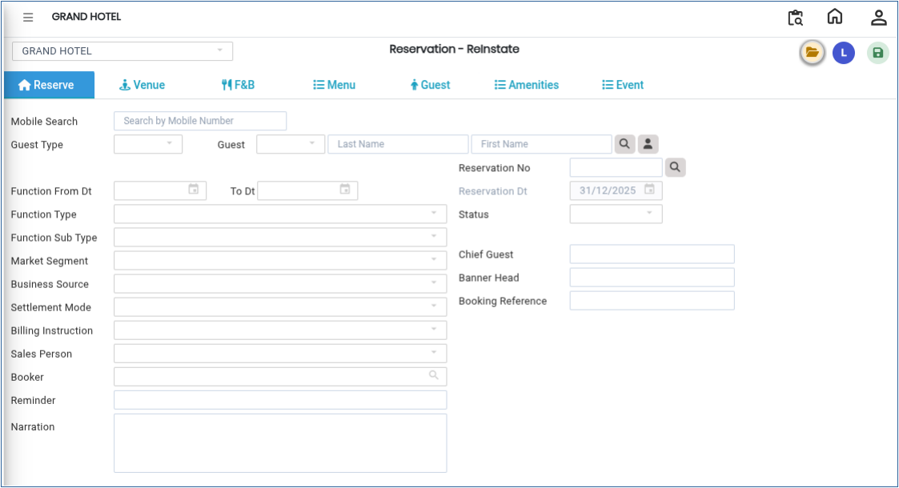

# Reservation - ReInstate

The **Reservation – ReInstate** option is used to restore or reactivate a previously cancelled or inactive reservation. Once the reservation is reinstated, users can modify reservation details such as venue, food & beverage options, menu, guest details, amenities, and event information before saving the changes.

## Steps to Create a Reservation – ReInstate

Step 1: Navigate to the **Banquet** menu.

1. Click on **Reservation – ReInState** under **Transaction.**

Step 2: Click the **Open** button.

1. The system will display the reservation search or creation window.

* Use this option to search for and reinstate an existing reservation.

<figure><figcaption></figcaption></figure>

Step 3:In the **Guest Name** field:

1. Type the guest’s name manually, **or**
2. Select the guest from the existing guest list.

* After selecting the guest, the reservation details will be displayed on the screen.

Step 4: Once the reservation has been reinstated, you can update or modify the  following details:

* Reservation information
* Venue details
* Food & Beverage (F\&B) details
* Menu selection
* Guest information
* Amenities
* Event details

Make the necessary changes according to the guest’s requirements.

Step 5: After verifying all updated details, click the **Save** button..png>)

1. The reservation will be successfully reinstated and updated in the system.
