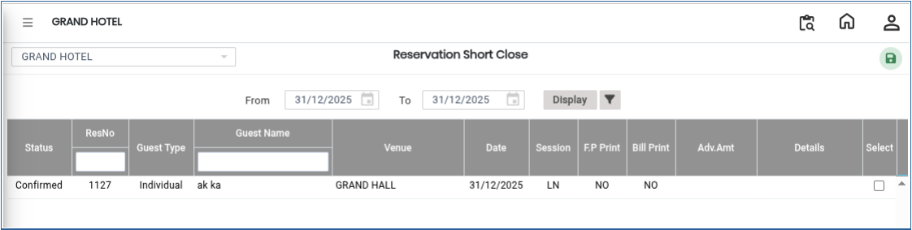
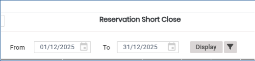
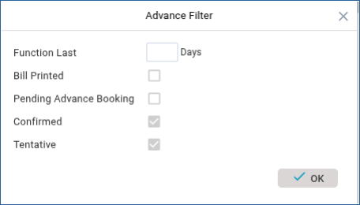

# Reservation Short Close

The **Reservation Short Close** feature is used to close reservations that are incomplete, inactive, or no longer required. This process helps users manage pending reservations efficiently and maintain accurate reservation records.

## Steps to Create a Reservation Short Close

Step 1: Navigate to the **Banquet** module and select **Transaction**.

1. Click on **Reservation Short Close**.

Step 2: After selecting **Reservation Short Close**, the screen will be displayed as shown below.

1. The screen contains reservation search and filtering options to identify the reservations that need to be short closed.

<figure><figcaption></figcaption></figure>

Step 3: Choose the required **From Date** and **To Date** range.

1. The system will display reservations based on the selected date range.

<figure><figcaption></figcaption></figure>

* This helps users search for reservations within a specific period.

Step 4: Click on the **Advance Search Filter** option.

1. The following filters can be applied to refine the reservation search:
   * **Function Days**
   * **Bill Printed**
   * **Pending Advance Booking**
2. Select the required filter options based on the reservation criteria.
3. The filtered reservation list will be displayed on the screen.

<figure><figcaption></figcaption></figure>

* Using filters helps users quickly identify the reservations that need to be short closed.

Step 5: Click the **Select** button for the required reservation.

1. Verify the guest details displayed on the screen.
2. Click the **Save** button.

* The selected reservation will be successfully short closed.
