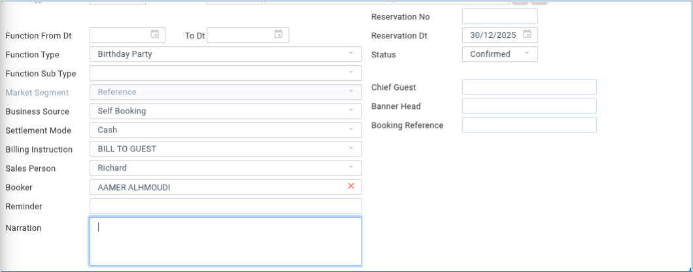
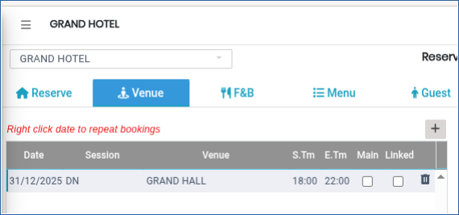
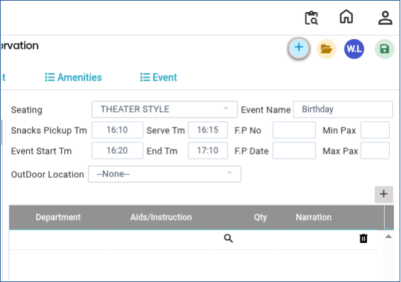

# Reservation

A **Reservation** is a record created in a system to block and manage a venue, event, or service for a specific guest on a selected date and time. It includes all event details such as guest information, venue, food & beverage (F\&B) plans, menus, amenities, and billing instructions.

### Steps to Create a Reservation

Step 1: Open **Banquet Module.**

1. Go to **Transactions.**
2. Click on **Reservation.**

Step 2: Click on the **New** button.png>)to start a new reservation.

Step 3: Enter Guest Details

* Select **Guest Type**:
  * Individual or Company
* Enter the **Guest Name** or select it from the existing guest profile

<figure><figcaption></figcaption></figure>

Step 4: Fill General Reservation Details

1. From the drop-down menus, select the following:

* Function Type
* Market Segment
* Business Source
* Settlement Mode
* Billing Instructions

<figure><figcaption></figcaption></figure>

Step 5: Enter Venue Details

1. Click on the **Venue tab**
2. Enter the following details:
   * Date of event
   * Session (Morning/Afternoon/Evening or as defined)
   * Venue name/location

<figure><figcaption></figcaption></figure>

Step 6: Enter Event Schedule and Setup Details

1. Fill in the following information:

* Seating Arrangement
* Snacks pickup time
* Service time
* Event start time
* Event end time
* Department requirements or aids&#x20;

<figure><figcaption></figcaption></figure>

Step 7: Click on the **F\&B (Food & Beverage) tab** to continue event planning.

<figure><figcaption></figcaption></figure>

Step 8: Enter F\&B Details.

1. Select the **Venue.**
2. Choose the **Plan.**
3. Enter Guaranteed Pax (minimum confirmed guests) and Expected Pax (estimated number of guests).

<figure><figcaption></figcaption></figure>

Step 9: Click on the **Menu section.**

* The system will display menu options based on the selected plan

<figure><figcaption></figcaption></figure>

Step 10: Choose the appropriate **Venue Menu.**

* Add required **add-ons** if needed under the menu section.

<figure><figcaption></figcaption></figure>

Step 11: Go to the **Guest Details tab.**

* Continue entering guest-related information

<figure><figcaption></figcaption></figure>

Step 12: Enter full **Guest Address.**

1. Fill in any additional required guest information.
2. Click **Save** and proceed to next step.

<figure><figcaption></figcaption></figure>

Step 13: Select the **Amenities menu.**

1. It will load based on the selected plan.
2. Choose the Venue and Applicable amenities
3. Enter the **charge rate** for each selected item

<figure><figcaption></figcaption></figure>

Step 14: Select the **Event menu**

* Choose the venue as required.
* Enter the **charge rate** for event-related services.

<figure><figcaption></figcaption></figure>

Step 15: After entering all required details, click on the **Save button.**.png>)

* The reservation will be successfully created and stored in the system

<figure><figcaption></figcaption></figure>
