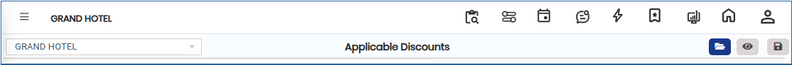
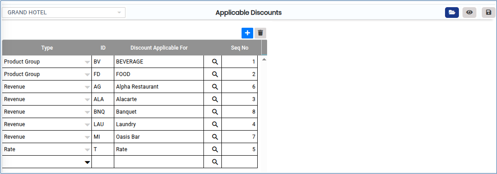
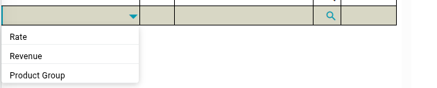
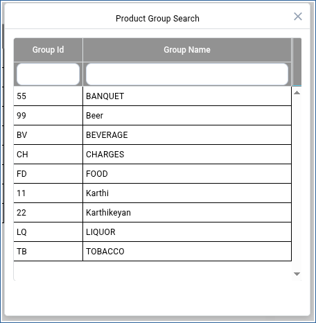

# APPLICABLE DISCOUNTS

**APPLICABLE DISCOUNTS**

1.To create a room, go to **“FRONT OFFICE”** module MASTERS RATE APPLICABLE DISCOUNTS NEW.

2.Click on open button we can able to see the Applicable Discounts.

<figure><figcaption></figcaption></figure>

3\. Click on Add button we can able to Add new Applicable Discounts.

<figure><figcaption></figcaption></figure>

4.Click on Down Arrow we can able to see the Rate,Revenue,Product Group  by chose we can able to add the Applicable Rate Type.

<figure><figcaption></figcaption></figure>

5.Click on Search Icon we can able to see the Product Group Search  by chose we can able to add the Group id,Group Name.

<figure><figcaption></figcaption></figure>

6.Then enter the Seq no add click on Save button it will be updated successfully.

<figure><figcaption></figcaption></figure>

&#x20;
