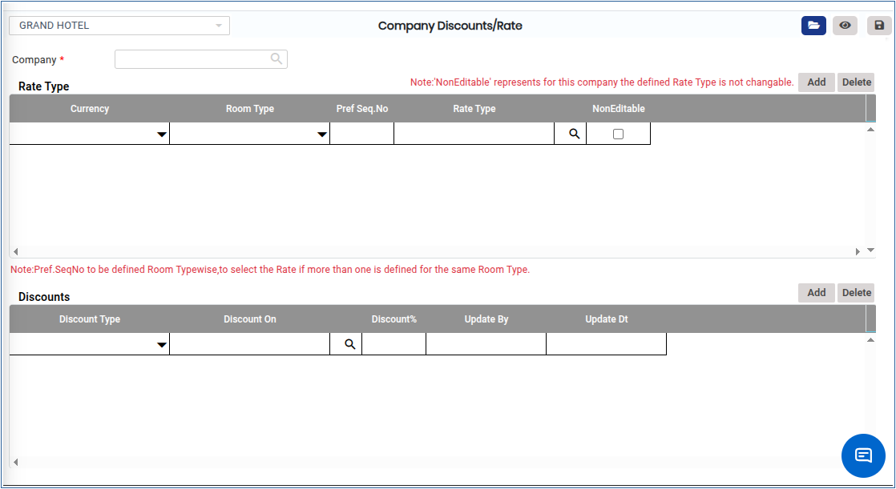
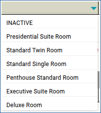

# COMPANY DISCOUNTS

**COMPANY DISCOUNTS**

1.To create a room, go to **“FRONT OFFICE”** module MASTERS RATE COMPANY DISCOUNTS NEW

<figure><figcaption></figcaption></figure>

2.Click on open button we can able to see the Company Discounts/Rate.

&#x20;

3.Click on Company we can able to see the Company Name.

<figure><figcaption></figcaption></figure>

<figure><figcaption></figcaption></figure>

4.By click on currency down arrow option we can able to add the currency.

<figure><figcaption></figcaption></figure>

5.Enter the Room Type,Room Rate As shown below.

<figure><figcaption></figcaption></figure>

6.Enter the Discounts Discounts type,Discounts on,Discounts %.

<figure><figcaption></figcaption></figure>

7.click on Save button it will updated successfully.
