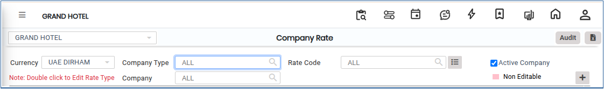
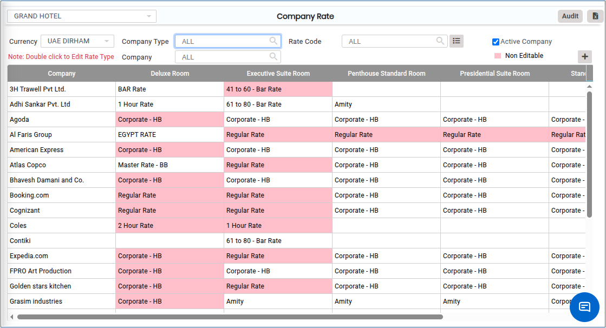
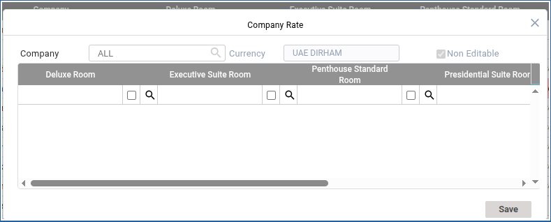

# COMPANY RATE

**COMPANY RATE**

1.To create a room, go to **“FRONT OFFICE”** module MASTERS RATE COMPANY RATE NEW.

2.Click on open button we can able to see the Company Rate.

<figure><figcaption></figcaption></figure>

3.Choose the Currency,Company Type,Company Type,Rate code.

<figure><figcaption></figcaption></figure>

4.Click on Add button,

<figure><figcaption></figcaption></figure>

5.Click on search icon we can able to see Rate Type Search is shown below.

<figure><figcaption></figcaption></figure>

6.Click on Save button Company Rate will Added successfully.
