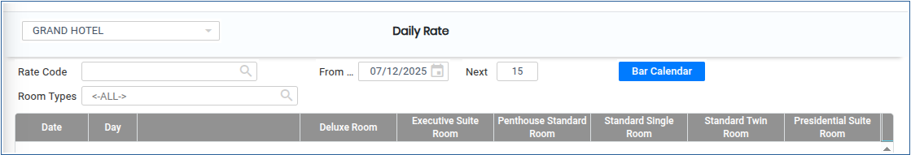
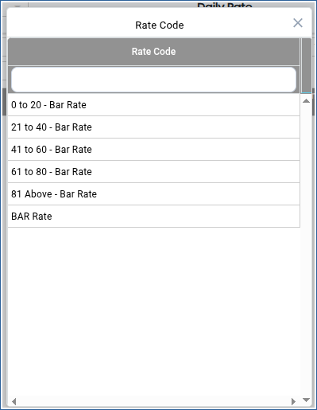
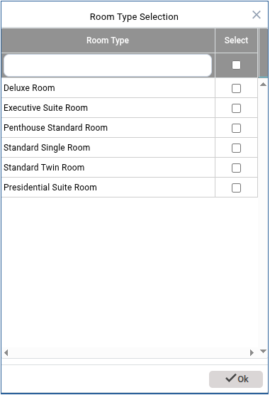
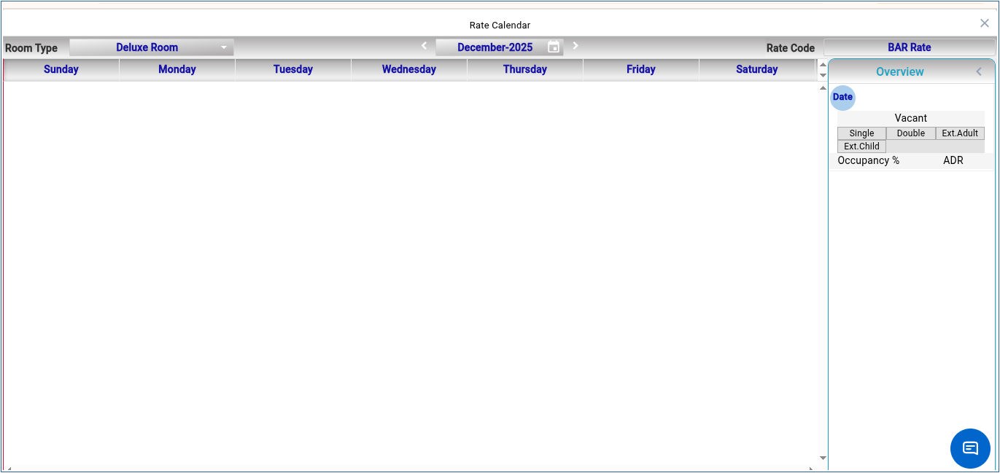

# DAILY RATE

**DAILY RATE**

1.To create a room, go to **“FRONT OFFICE”** module MASTERS RATE DAILY RATE NEW.

<figure><figcaption></figcaption></figure>

2.Click on open button we can able to see the Daily Rate.

&#x20;

3.Click on Rate Code search button and choose the rate code.

<figure><figcaption></figcaption></figure>

4.Click on Room Type Selection below.

<figure><figcaption></figcaption></figure>

5.Then Click on Bar calender Daily Rate will be shown below.

<figure><figcaption></figcaption></figure>

