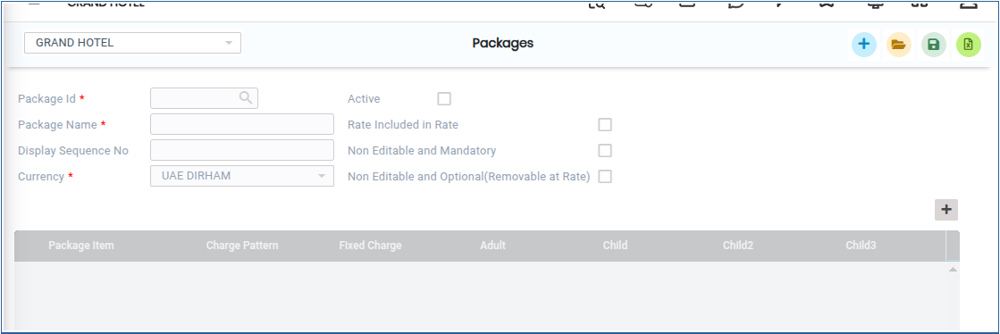
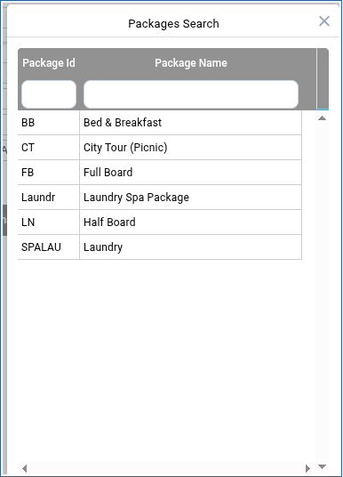
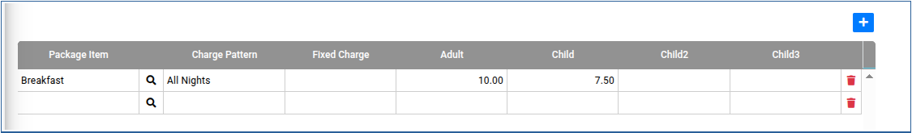
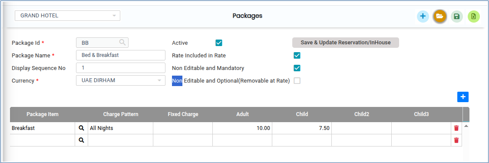

# PACKAGES

**PACKAGES**

1.To create a room, go to **“FRONT OFFICE”** module MASTERS RATE PACKAGES NEW.

2.Click on open button we can able to see the PACKAGES.

<figure><figcaption></figcaption></figure>

3.Click on Package Id and chose the Package name

<figure><figcaption></figcaption></figure>

4.Click on Add new button we can add the Packages.

<figure><figcaption></figcaption></figure>

5.Once the Packages is Added click on Save button it will be updated successfully.

<figure><figcaption></figcaption></figure>

