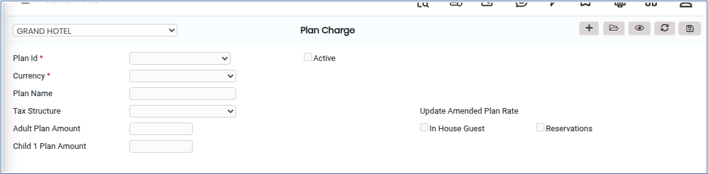

# PLAN CHARGE

**PLAN CHARGES**

1.To create a room, go to **“FRONT OFFICE”** module MASTERS RATE PLAN CHARGE NEW.

2.Click on open button we can able to see the PLAN CHARGE.

<figure><figcaption></figcaption></figure>

3.Click on responding Update Amended Plan Rate.

<figure><figcaption></figcaption></figure>

4.Click on New button we can see the Plan Charge in this we need to choose the Plain id,Currency,Plan name,Tax structure.

<figure><figcaption></figcaption></figure>

5.Once Plan Charge is created click on Save button it will be updated Successfully.

