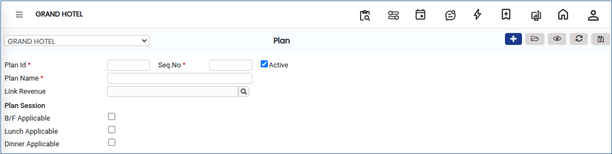
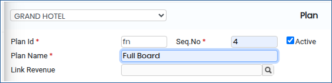
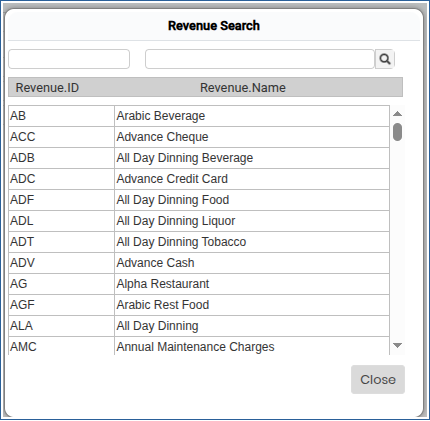
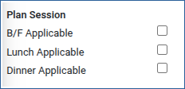

# PLAN

**PLAN**

1.To create a room, go to **“FRONT OFFICE”** module MASTERS RATE PLAN NEW

2.Click on open button we can able to see the Plan.

<figure><figcaption></figcaption></figure>

3.Add the plan details like Plan id,Seq no,Plan Name.

<figure><figcaption></figcaption></figure>

4.Click on Link Revenue It will shows the Revenue list by clicking the Revenue will be added successfully.

<figure><figcaption></figcaption></figure>

5.Below Screen shows the Plan Session.

<figure><figcaption></figcaption></figure>

6.Click on Save Button it will be updated successfully.
