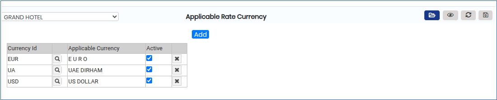
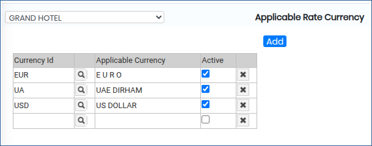
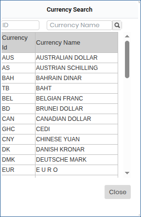

# RATE CURRENCY

**APPLICABLE RATE CURRENCY**

1.To create a room, go to **“FRONT OFFICE”** module MASTERS RATE RATE CURRENCY NEW.

2.Click on open button we can able to see the Applicable Rate Currency.

<figure><figcaption></figcaption></figure>

3\. Click on Add button we can able to Add new Rate Currency.

<figure><figcaption></figcaption></figure>

4.Click on Search Icon we can able to see the Currency Name by chose we can able to add the rate currency.

<figure><figcaption></figcaption></figure>

5.Click pon Save button Rate Currency will be added successfully.

<figure><figcaption></figcaption></figure>
