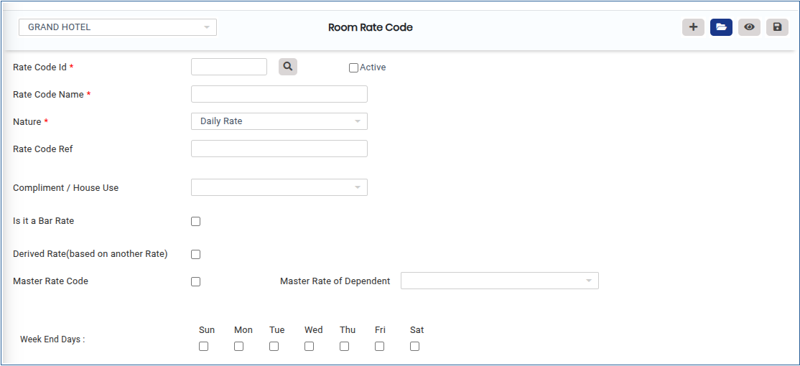
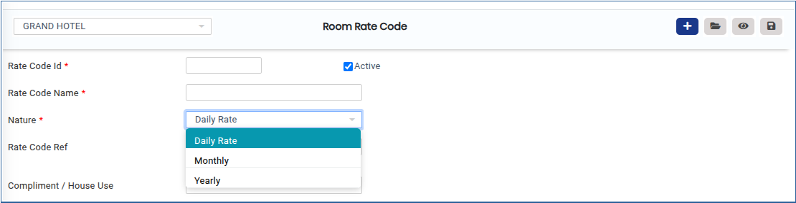
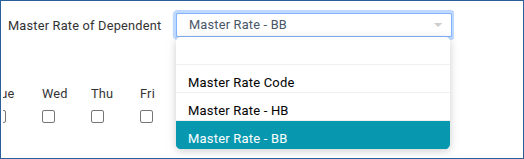
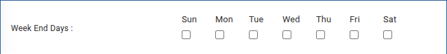

# ROOM RATE CODE

**ROOM RATE CODE**

1.To create a room, go to **“FRONT OFFICE”** module MASTERS RATE ROOM RATE CODE NEW

2.Click on Add button we can able to add the new ROOM RATE CODE.

<figure><figcaption></figcaption></figure>

3\. Add the corresponding Section Rate Code Id ,Rate Code Name,Nature shown below.

<figure><figcaption></figcaption></figure>

4.Click on Master Rate of Dependent Shown below.

<figure><figcaption></figcaption></figure>

5.Below Screen shows the week End Days we need to update the Room Rate code we can able to choose.

<figure><figcaption></figcaption></figure>

6.Click on Save button it will updated successfully.

<figure><figcaption></figcaption></figure>
