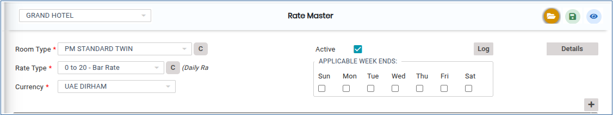
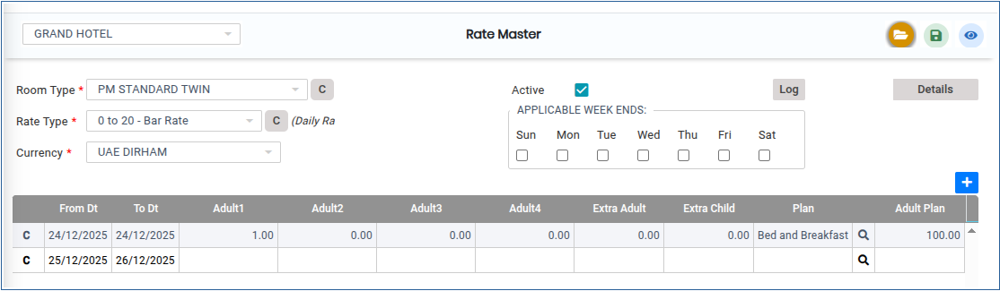
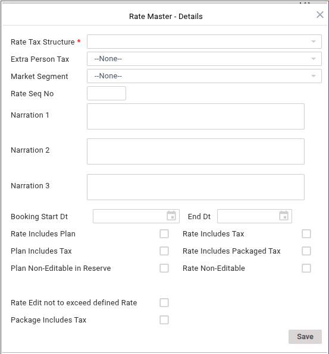
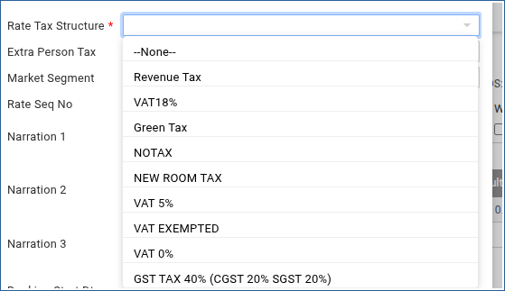
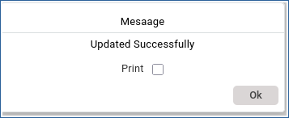

# ROOM RATE

Steps to create a Room Rate.

**ROOM RATE**

1.To create a room, go to **“FRONT OFFICE”** module MASTERS RATE ROOM RATE NEW

2.Click on Add button we can able to add the new ROOM RATE.

<figure><figcaption></figcaption></figure>

3\. Add the corresponding Section Room Type,Rate Type,Currency shown below.

<figure><figcaption></figcaption></figure>

4.Once the Rate Master Entered add option menu the From date,Adult,Plan,Adult Plan hasbeen shown.

<figure><figcaption></figcaption></figure>

5.Select on Details we can able to chose the Rate Master - Details shown below

<figure><figcaption></figcaption></figure>

<figure><figcaption></figcaption></figure>

7.Click on Save button Room Rate will be updated successfully.

<figure><figcaption></figcaption></figure>
