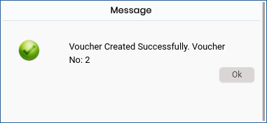

# NA GL posting

**NA GL posting**

This option is used to posting the Night Audit  to General Ledger. This option can be used after the Night Audit is done.

**Steps to NA GL posting.**

1.Go to **Night Audit Main Menu**.

2.Click on **Night Audit  > NA GL posting**.

3.Once the user has opened the NA GL posting the below screen will appear. By default, the PMS will display the current dafor which the Tariff is to be posted.

<figure><figcaption></figcaption></figure>

4.Click on POST button Night Audit Revenue will posted to General Ledger.

<figure><figcaption></figcaption></figure>

5.Click ok Button NA GL will be posted successfully.

<figure><figcaption></figcaption></figure>

