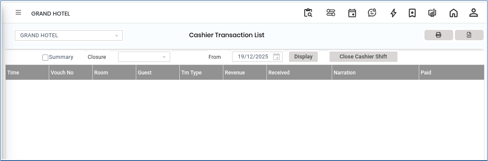

# Cashier Transaction List

**Cashier Transaction List**

1.To view the report, go to FRONT OFFICE > NIGHT AUDIT > Cashier Transaction List.

2.click on display button.

<figure><figcaption></figcaption></figure>

3.Then click close cashier shift to close the cashier shift.

<figure><figcaption></figcaption></figure>

4.click on save button to save the cashier shift closer.

<figure><figcaption></figcaption></figure>
