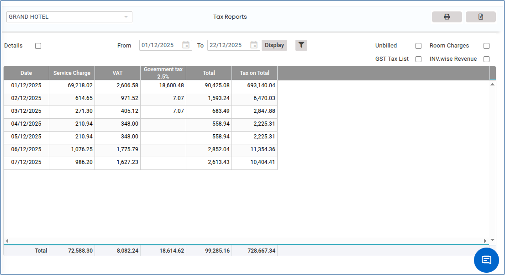
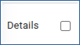
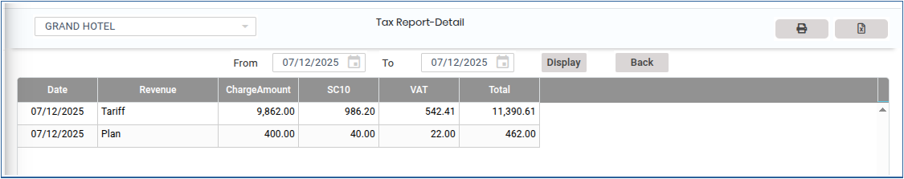
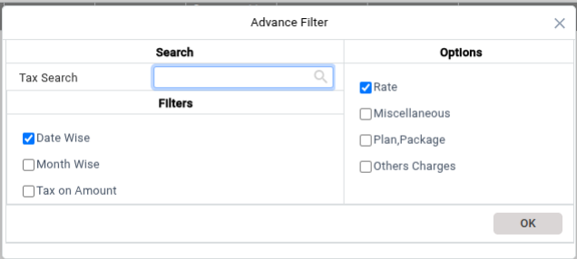
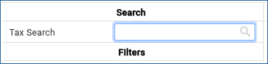
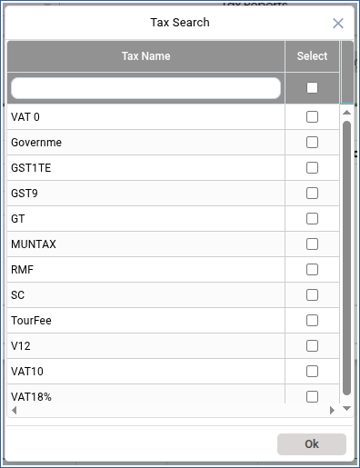

# Tax Report

This report shows the tax which has been collected from the guests. And from within this report you can also see the Service charge.VAT,Government tax posted and if any kind of tax has been collected for a selected date period.

<figure><figcaption></figcaption></figure>

Click on Details button you can able to see the tax report details.

<figure><figcaption></figcaption></figure>

<figure><figcaption></figcaption></figure>

<figure><figcaption></figcaption></figure>

<figure><figcaption></figcaption></figure>

<figure><figcaption></figcaption></figure>
