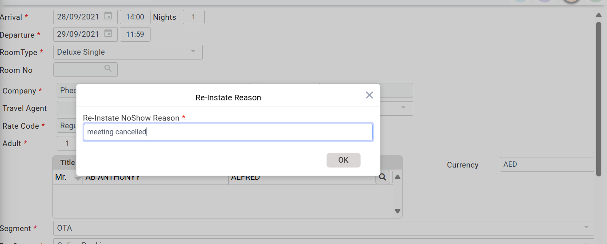

# Reinstate No Show Reservation

1\. Go to the **Reservation Main Menu**

2\. Click on the ellipsis (the three vertical Dots) on the menu bar > **ReInstate NoShow.**

<figure><figcaption></figcaption></figure>

3\. Once the user has clicked on **ReinNoShow,** the following window listing out all no-show reservations will appear. Then the user has to select the reservation that they would like to reinstate.

.png>)

4. Double-click on the reservation row to select the Reservation.
5. Save the reservation to reinstate.&#x20;
6. &#x20;The Below Pop-up will appear. Enter the reason for reinstating and click OK.

<figure><figcaption></figcaption></figure>
