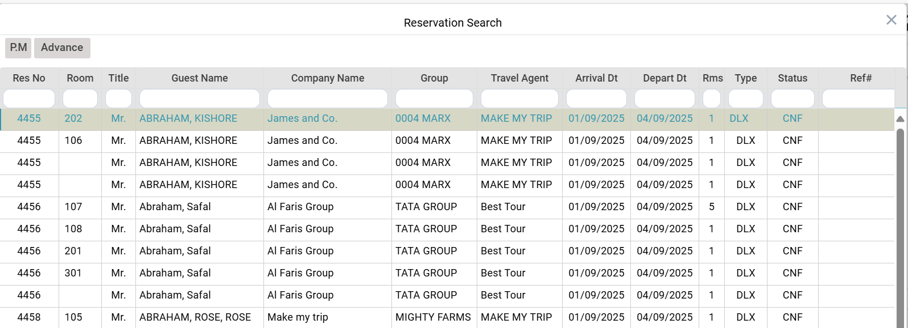
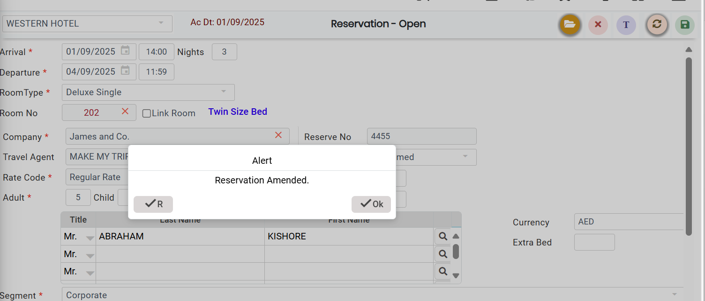

# Reservation Amendment

### Editing your existing Reservation

* To Edit an existing reservation, Go to Reservation.&#x20;
* Open folder from the submenu bar to open the reservation list.
* Select the reservation to be amended from the reservation list.
*   Double click on the reservation to open it.

    <figure><figcaption></figcaption></figure>
* Make the necessary changes and save the reservation.
*   A pop up message confirming the amendment is displayed. Click Ok to confirm.

    <figure><figcaption></figcaption></figure>
