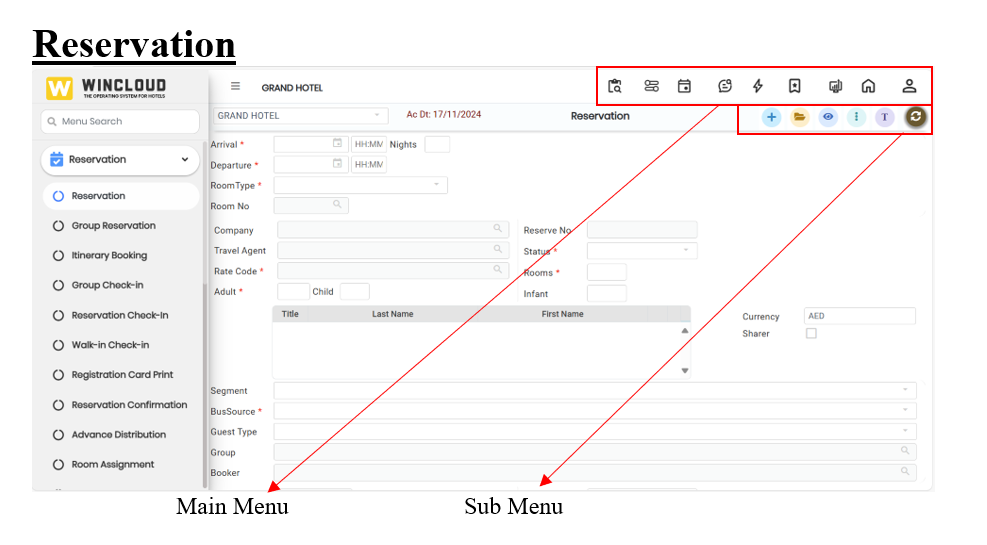

# Getting Started

### Reservation

<figure><figcaption></figcaption></figure>

### **Main Menu**

The main menu in Wincloud is the central navigation area that provides access to the primary functions and features of the applications. The main menu helps users move efficiently through the software and perform key tasks.

<figure><figcaption></figcaption></figure>

**Custom Report**  : Customized Layout to design the user-defined report. It is designed to provide insights relevant to a certain user or department.

**Room Position**  : The Room Position feature assists front desk staff in efficiently managing room allocations and monitoring occupancy levels based on real-time availability.

**Key Features:**

*   **Room Assignment by Availability:**&#x20;

    Enables front desk staff to assign rooms to guests based on current availability for a selected date range or specific period, ensuring optimal room utilization.&#x20;
*   **Room Type-wise Breakdown:**&#x20;

    Provides a detailed view of available rooms categorized by room type (e.g., Deluxe, Standard, Suite), helping staff make informed allocation decisions according to guest preferences and booking requirements.&#x20;
* **Day-wise Occupancy Percentage:**&#x20;
  * Displays occupancy data in a day-by-day format, including:&#x20;
  * Total available rooms&#x20;
  * Booked rooms.&#x20;
  * Occupancy percentage per room type&#x20;
* **Benefits:**&#x20;
  * Enhances operational efficiency by simplifying the room assignment process.&#x20;
  * Improves decision-making with access to room type-wise and daily occupancy insights.&#x20;
  * Supports better resource planning and forecasting of room utilization.&#x20;

**Calendar**  : The Calendar View is a comprehensive scheduling interface that displays dates and booking information in a structured, date-based format. It is designed to help users effectively manage room availability, reservations, and housekeeping operations.

**Key Features:**

*   **Visual Booking Interface:**&#x20;

    Displays room availability, reservations, and housekeeping schedules in a clear and organized calendar format.&#x20;
*   **Interactive Booking Management:**&#x20;

    Users can view, add, and manage bookings directly from the calendar interface, improving operational efficiency.&#x20;
*   **Integrated Operational Features:**&#x20;

    The calendar is linked with other core functionalities, including:&#x20;

    * **Unassigned Rooms:** View and assign rooms that have pending allocations.&#x20;
    * **Due In:** Easily track and prepare for incoming guests on a given date.&#x20;
    * **Due Out:** Monitor scheduled departures to manage check-out processes and housekeeping.&#x20;

**Date-Based Filtering:**&#x20;

Users can filter the calendar by specific dates to focus on particular time frames, allowing for precise planning and better resource allocation.&#x20;

**Benefits:**&#x20;

* Provides a centralized view for real-time room and reservation management.&#x20;
* Enhances coordination across departments (e.g., front desk, housekeeping).&#x20;
* Increases visibility and control over guest flow and room turnover.&#x20;

**Trace**  : Refers to a reminder or task assigned to staff related to a guest, reservation, or internal operation. It is used to ensure tasks are completed at the right time (contacting a guest, preparing a room, or delivering a service request). Traces are often visible on dashboards and help improve guest service, communication, and operational efficiency.

**Flash**  : The Room Management Flash Screen provides a centralized interface for accessing critical operational information and performing key transactions within the property management system. It is designed to enhance efficiency by consolidating multiple functions into a single, user-friendly screen.

**Key Features:**

*   **Room Status Overview:**&#x20;

    Quickly view the real-time status of all rooms (e.g., vacant, occupied, dirty, under maintenance).&#x20;
*   **In-House Guest List:**&#x20;

    Access a complete list of currently checked-in guests, including room numbers and stay details.&#x20;
*   **Room Positioning:**&#x20;

    Visualize the allocation and layout of rooms to manage occupancy and housekeeping schedules effectively.&#x20;
*   **Expected Arrivals and Departures:**&#x20;

    Generate instant reports on upcoming arrivals and scheduled departures to better manage front desk operations and guest flow.&#x20;
*   **Transaction Capabilities:**&#x20;

    The Room Status screen is not just for viewing information—it also allows direct execution of core transactions, including:&#x20;

    * &#x20;**Reservation Management:** Create, modify, or cancel room reservations directly from the screen.
    * **Guest Check-In:** Seamlessly process check-ins with minimal steps and real-time updates to room status.
    * **Guest Check-Out:** Complete the check-out process, including billing and room release, all within the same interface.

**Favourites**  : The Application Menu Search feature enhances user navigation by providing a streamlined method to locate specific menu items, including Transactions, Reports, and Masters, based on the user's access rights.

**Key Functionalities:**

*   **Menu Search Based on User Rights:**&#x20;

    Users can search for application menus that fall under the categories of Transactions, Reports, and Masters. The search results are filtered based on the individual user's access permissions, ensuring that only authorized options are displayed.&#x20;
*   **Add to Favourites:**&#x20;

    To improve accessibility and efficiency, users can mark frequently accessed menus as Favourites. These menus are then available in a dedicated section, allowing quick and convenient access without needing to perform a search each time.&#x20;
*   **Benefits:**&#x20;

    Saves time by eliminating the need to navigate through multiple levels of menus. This also enhances productivity by allowing quick access to frequently used features. Also improves user experience with a personalized and organized menu interface.&#x20;

**Dashboard**  : It is a central screen that provides a real-time overview of key hotel operations and performance indicators. It displays important information such as room occupancy, reservations, arrivals and departures, housekeeping status, revenue, and guest requests, all in one place. Dashboards help staff make faster, informed decisions and improve operational efficiency.

**Home**  : Refers to the main landing page that appears after logging in. It serves as the central hub where users can access key functions and get an overview of daily hotel operations. Home indicates a summary view of all reservations, room status,\
housekeeping reports, pending tasks. It is the starting point that helps staff navigate the system efficiently and stay informed about what needs attention.

**Profile**  : A profile refers to a stored record containing key information about a guest company, travel agent, or group. Profiles are used to streamline operations, personalize service, and maintain accurate records for future use. A few examples are Guest profile, Company Profile, Travel Agent Profile, and Group Profile. Profiles speed up future reservations by auto-filling known details. Helps deliver personalized service (room preferences, special requests). Track loyalty points, billing arrangements, or marketing preferences. Ensures data consistency across multiple stays or departments.

### Sub Menu

<figure><figcaption></figcaption></figure>

**Add New item/Create New Entry** 

* Add a new reservation,
* Add a new guest profile
* Add a new room or room type
* Add a new task or request
* Add a new inventory item
* Add a new housekeeping task

**Open** 

The Open icon displays a list of all reservations in the system and allows users to open them for further editing when modifications are needed. Reservations can be searched using any parameter stored in the reservations list. An Advanced Search option is also available within this window for more specific filtering. To edit a reservation, double-click the desired entry to open it for modifications<mark style="background-color:$info;">.</mark>

**View** 

The View icon displays a complete list of all reservations in the system, regardless of date. This provides users with a comprehensive view of both past and future reservations. Reservations can be searched using any parameter stored in the reservations list. An Advanced Search option is also available within this window for more precise filtering.

**Trace** 

Refers to a reminder or task assigned to staff related to a guest, reservation, or internal operation. It is used to ensure tasks are completed at the right time (contacting a guest, preparing a room, or delivering a service request. Traces are often visible on dashboards or staff task lists and help improve guest service, communication, and operational efficiency.

**Refresh** 

The refresh button updates the screen to show the latest information.&#x20;

* See new bookings&#x20;
* Update room status&#x20;
* Load any recent changes&#x20;

**Save** 

The save button is used to keep or store the changes you have made.

* Save a new booking&#x20;
* Save guest details&#x20;
* Save room updates or tasks&#x20;
* Save invoices or payments&#x20;
