# Group Reservation

· Click on the new button at the bottom of the Group Search screen.

· Add a new Group name, contact, company, Travel agent, and Country.

· Click the OK button to save.

<figure><figcaption></figcaption></figure>

**Group reservation search**

By clicking search icon

<figure>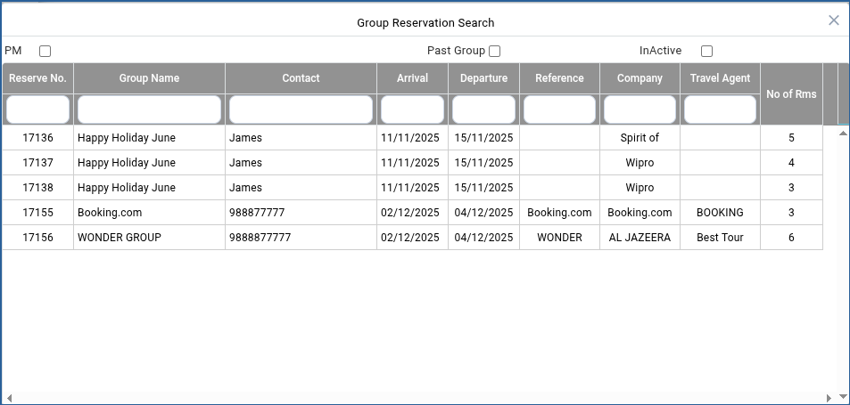<figcaption></figcaption></figure>

**BOOKER PROFILE**

A Group can be created from the **Booker Search Screen. Creating a Booker Profile from Masters**

**Creating a Booker from the Booker search screen.**

· Click on the new button at the bottom of the Booker Search screen.

· Add a new Booker name, Title, Company, Telephone, Email, and Mobile.

· Click the OK button to save.

**Modifying the Booker**

Navigate to the Booker Search Screen.

Select the specific group and click the ‘Amend’ button to modify the booker profile.

Click the OK button to save the changes.

The rates are displayed in the rate box in the WinCloud reservation screen based on the plan, room, and guest specifications.

· Click on the new button at the bottom of the Group Search screen.

· Add a new Group name, contact, company, Travel agent, and Country.

· Click the OK button to save.

**Modifying the Group**

· Navigate to the Group Search Screen.

· Select the specific group and click the ‘Open’ button to modify the group.

· Click the OK button to save the changes.

<figure>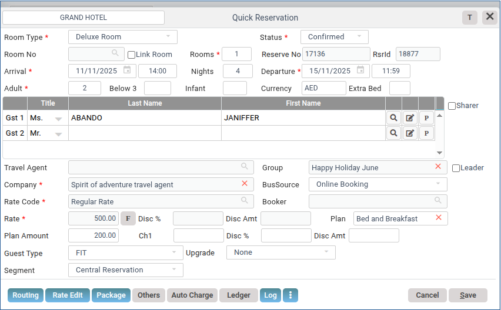<figcaption></figcaption></figure>

2.The rates are displayed in the rate box in the WinCloud reservation screen based on the plan, room, and guest specifications.

<figure>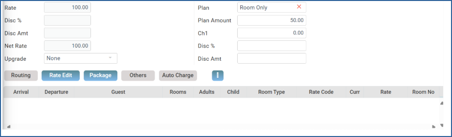<figcaption></figcaption></figure>

**Routing:** If the bill needs to be split among guests while creating a reservation, this button can be applied. In Wincloud, routing can be applied at four junctures.

1\. While creating the reservation.

2\. While Checking in.

3\. After Check in.

4\. While checking out.

The routing button enables advanced bill splitting during reservation creation. This saves the effort of manual bill splitting.

**To create a routing:**

· Click on the routing button after the guest and room creation is over. This takes you to the routing wind

<figure>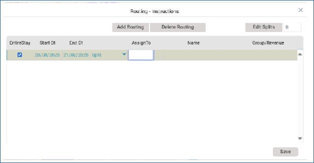<figcaption></figcaption></figure>

· ‘Assign to’ field tells WinCloud the number of splits assigned to the reservation.

· Name will be automatically selected based on the number of splits.

· In the Edit split button, we specify the Guest name or Company Name. Payments/collections and Tips.

<figure>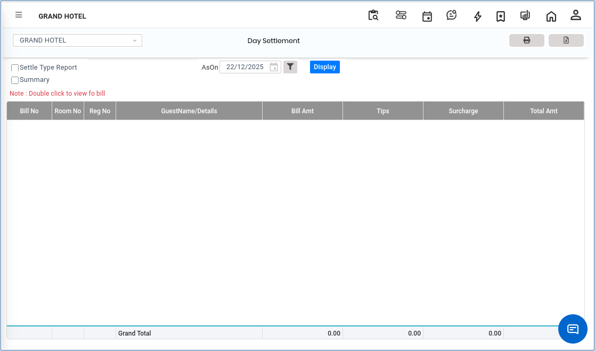<figcaption></figcaption></figure>

Next, click on the group/ Revenue field to select the group and revenues to be split

<figure>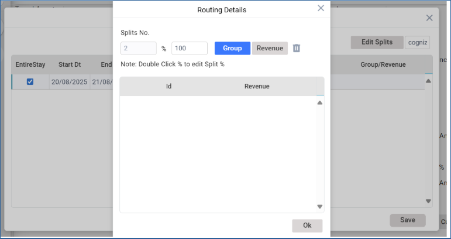<figcaption></figcaption></figure>

· Double-click on the Group button to enter the group name and click OK.

· Double-click on the revenue button to select the revenues to be split and click OK.

· Save the routing preferences.

**Rate Edit**

The Rate Edit button allows for modifying rates if they need to be amended after a reservation is created or while creating a reservation.

**To edit a rate:**

1.While a reservation is in progress, immediately **click the Rate Edit button.**

2.If the reservation is already created, then click the **Open icon** from the reservation screen.

a.Select the reservation from the list.

b.Click the Rate Edit button to edit rates.

3.Clicking the ‘Restore to standard rate’ button restores the room rate to the standard rate allocated for the room.

4.The Log button displays all the rate changes that have been applied to the reservation.

5.Save the screen.

<figure>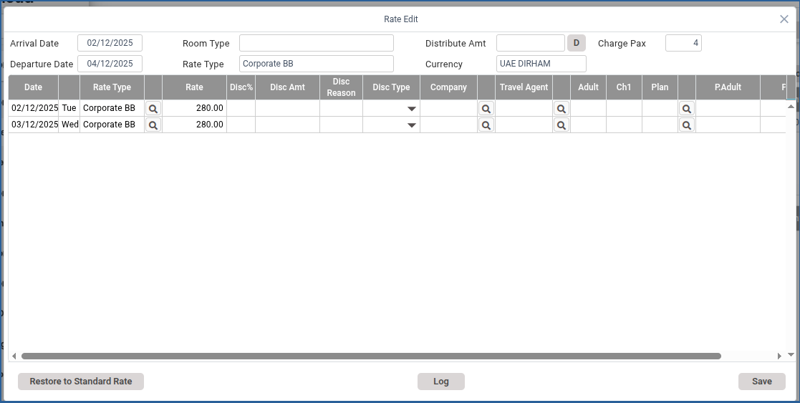<figcaption></figcaption></figure>

**o edit/amend the defined daily rate for a particular In-house Guest.**

· Go to Front Office>>Reservation >> Reservation (Open Mode)

· Select the reservation to be amended.

**Package**

The **Packages button** can be used to allocate a package to a guest. The packages are pre-created in Guest Specialities >> Packages.

· Click on the package button to open the Package allotment window

<figure><figcaption></figcaption></figure>

pon clicking the **package button** on the top right corner, a list of packages appears.

<figure>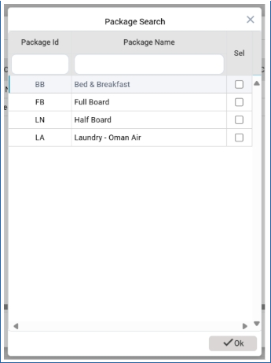<figcaption></figcaption></figure>

· Select the package that you intend to apply to the reservation and click the OK button.

· If the guest requests additional services—such as an extra bed, a city tour, or taxi service—click the Revenue button next to the package.

<figure>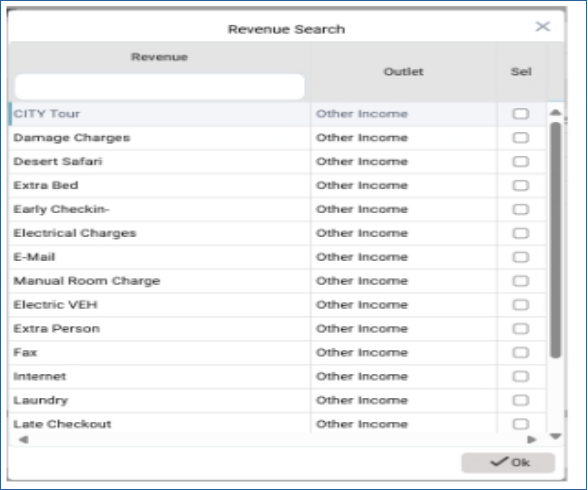<figcaption></figcaption></figure>

· From the **Revenue Search list**, select the services. And click **OK.**

· This action will add the selected services to the guest’s package and close the list.

· Save the package.

**Others**

Others help you input those other important guest details into the guest profile. This helps you include any reservation instructions, many other instructions relevant to the guest.

<figure>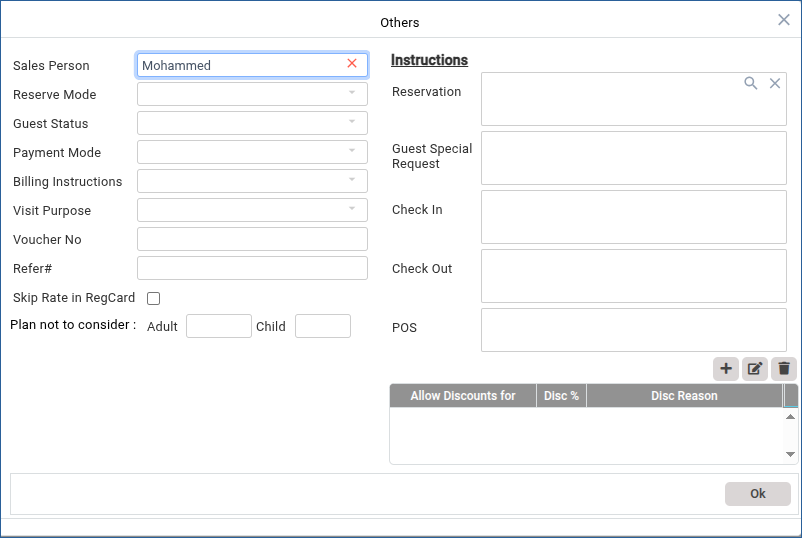<figcaption></figcaption></figure>

Click the OK button to save the information.

**Auto Charge.**

Any additional charges can be charged using the Auto charges section.

<figure>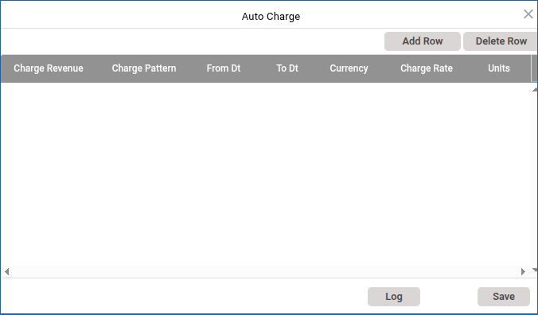<figcaption></figcaption></figure>

· Click on the add row button to select the other revenues to be added to the reservation.

· Select revenue rows.

· Click OK.

**Advance Room Search and Room Position.**

<figure>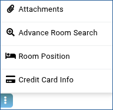<figcaption></figcaption></figure>

**QUICK RESERVATION**

Quick reservations can be created using the calendar icon from the reservation screen.

#### To Create a Quick Reservation

· Goto Front Office>> Reservations >> reservations

· Click on the calendar icon the calendar on the menu bar.

<figure>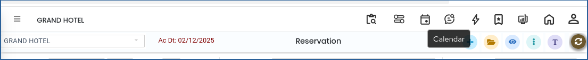<figcaption></figcaption></figure>

· Clicking on the calendar icon opens the calendar screen.

<figure>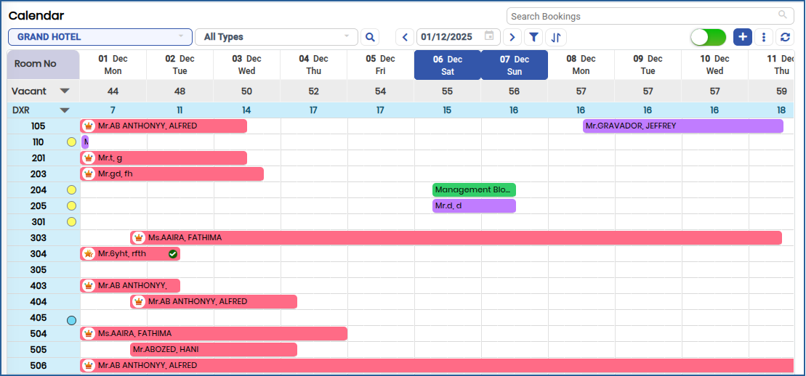<figcaption></figcaption></figure>

Select the room type from the room field if the guest wants a specific type of room.

<figure>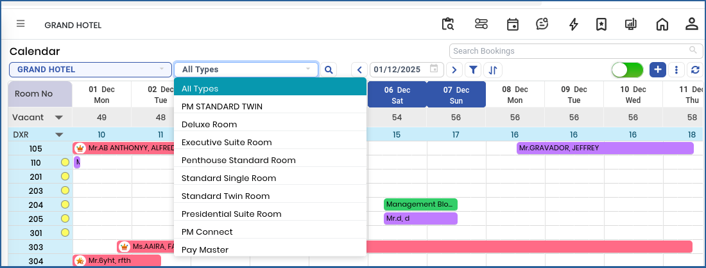<figcaption></figcaption></figure>

· On the c**alendar screen, click and drag** the cursor from the desired **arrival date** to the **departure date**.

· A **pop-up window** will appear, offering the option for a quick reservation.

<figure>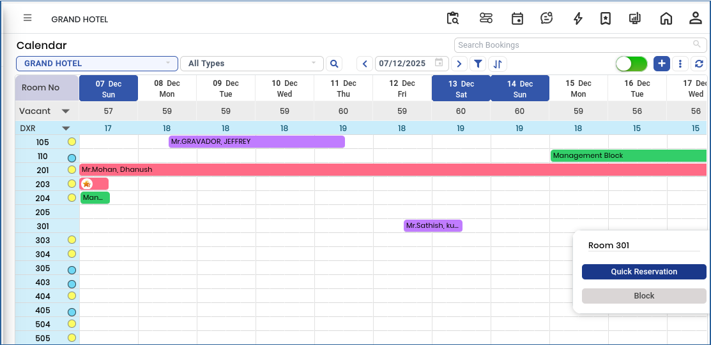<figcaption></figcaption></figure>

· Select **Quick Reservations** to open the full **Reservation Window**, where you can complete and confirm the booking.

<figure>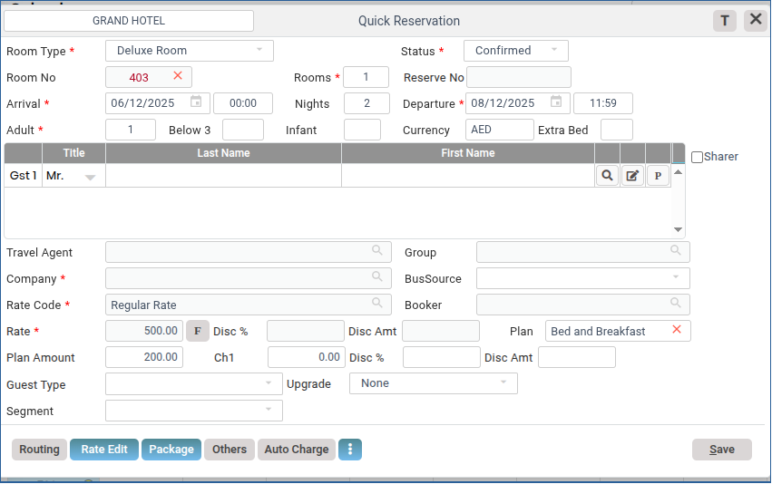<figcaption></figcaption></figure>

· The Quick Reservation window will automatically populate the arrival and departure dates based on your selection from the calendar screen

· If no room type is selected, the system will automatically assign an available room. Enter the number of guests by filling in the Adults (Pax) field.

· Create or select the guest profile:

· For a repeat guest, use the search icon to find and select the existing profile from the list.

· For a new guest, create a new profile by entering the required details.

<figure>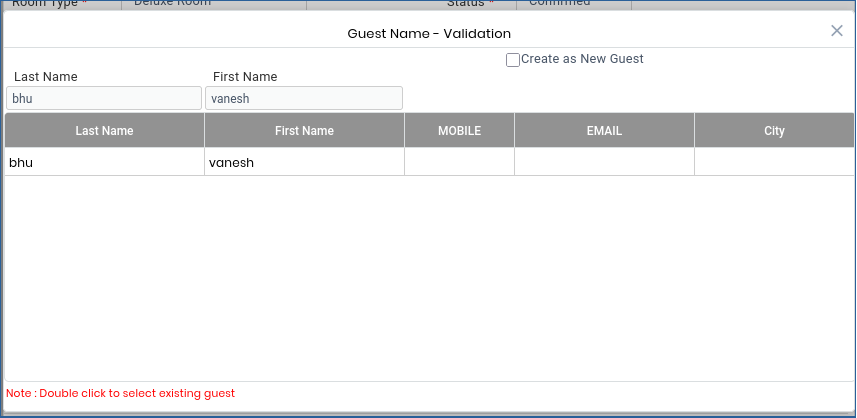<figcaption></figcaption></figure>

· Check the Create as new Guest button.

· Fill in the mandatory fields to complete the reservation.

· Save to create a new reservation.

## GROUP RESERVATION

Steps to create Group Reservation

**Goto Front office >> Reservation >> Group Reservation.**

To create **Group Reservations**, a **Group Master** record must first be created in the system. The Group Master serves as the primary record that consolidates and manages all related reservations under a single group. Once the Group Master is created, it must be linked with the relevant individual reservations. Based on these linked records, the system will allow the creation of **Group Bookings**, enabling centralized management of reservations, billing, and reporting for the entire group.

Click on the Create New Reservation icon as shown below.

<figure>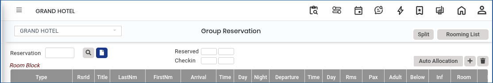<figcaption></figcaption></figure>

· Create a New group and save.

<figure>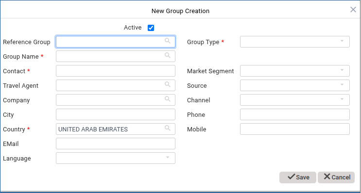<figcaption></figcaption></figure>

ter saving, the system will automatically display a **Quick Reservations** pop-up window. This pop-up allows you to immediately add and manage reservations associated with the newly created group.

· Select room type, select the arrival and departure date, Rooms, Guest Name, Rate Code, Guest Type, and Market segment as shown below, and click save.

<figure>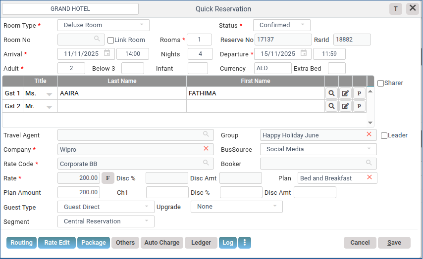<figcaption></figcaption></figure>

· Once the reservation is created, you will see the reservation on the screen like this.

<figure>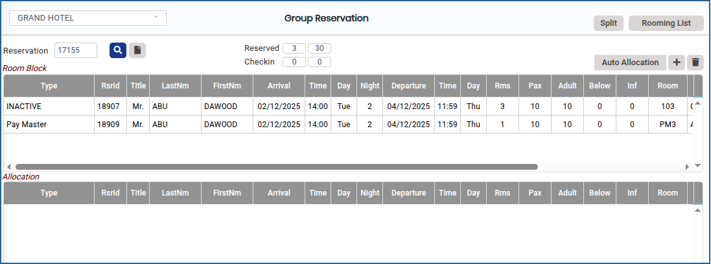<figcaption></figcaption></figure>

Click the **Split button** to split the booking between all the guest.

To split the booking, select the reservation line.

Click the split button.

Enter the number of splits to be created in the field.

Click create.

<figure>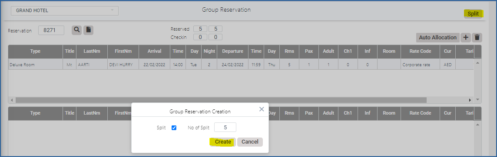<figcaption></figcaption></figure>

· Group Reservation Created Successfully

<figure>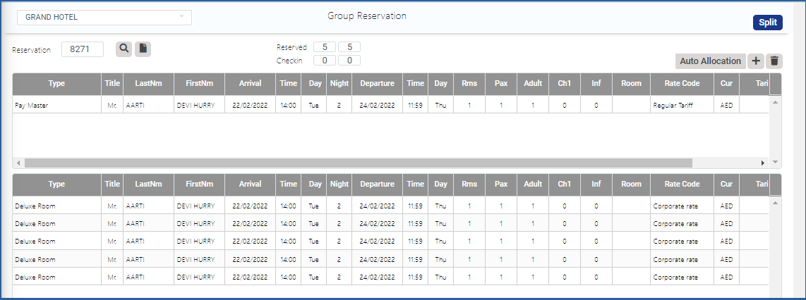<figcaption></figcaption></figure>

· To allocate the specific rooms to the guests, click the Auto-allocate button.

<figure>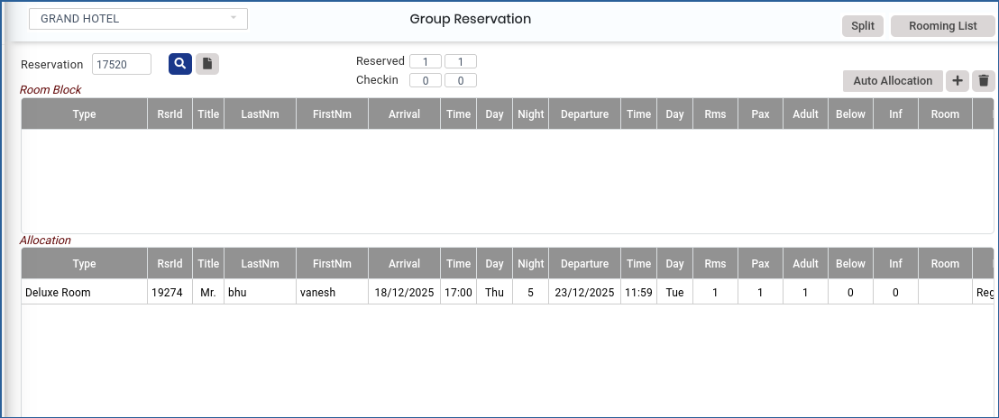<figcaption></figcaption></figure>
