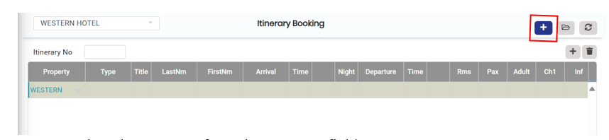
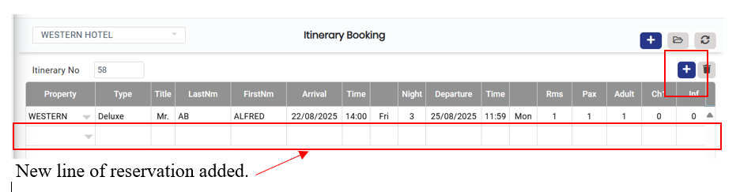

# Itinerary Booking

Itinerary booking is done for those Guests who want to create multiple bookings for different locations that fall within the same property/group.

### Steps to Create an Itinerary Booking

1. Go to Reservation and click the Itinerary Booking sub menu
2. Click on the plus icon (+) on the itinerary booking menu to add or select a property.

<figure><figcaption></figcaption></figure>

* Next, select the property from the property field

<figure><figcaption></figcaption></figure>

4. After selecting the property, double-click on the property name to open the reservation detail screen.&#x20;
5. Fill in the quick reservation details as shown below and save.&#x20;

<figure><figcaption></figcaption></figure>

Tip: You can also edit the rate, route, add a package, and add other charges from this screen as well.

6. To add a new reservation, click on the plus icon (+) within the itinerary screen. This line can be added to book another property for the same guest.

<figure><figcaption></figcaption></figure>

7. Select the new property from the property field.&#x20;
8. Double-click on the property to open the reservation detail screen.&#x20;
9. Once the detail screen opens, enter the reservation details and save the reservation for the new location. &#x20;
