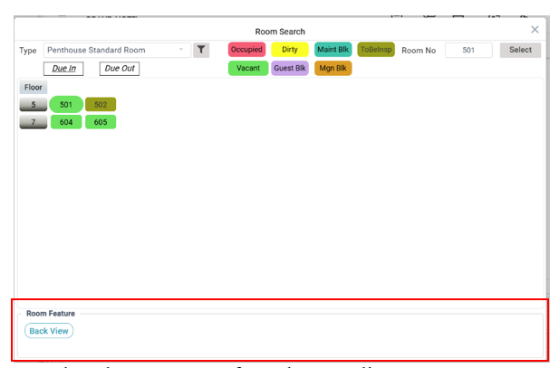
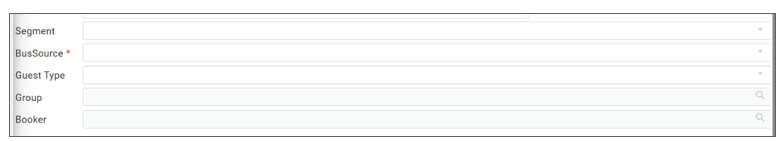

# Reservation Creation

### **Creating a new Reservation**

1. Go to Reservation **from the Main Menu**.
2. Select **Reservation** from the Reservation menu.
3. Click on the **Add new item button** to add/create a new reservation.
4. Choose a **Room type** from the drop-down list.
5. Select **Arrival Date** using the date picker or **calendar icon**.
6. Add the **number of Nights, number of Adults, and children**.

<figure><figcaption></figcaption></figure>

7. The **Room number** field takes you to a room search screen where you are allowed to select room/ rooms from the available rooms.

&#x20;       **Room Search Screen**

<figure><figcaption></figcaption></figure>

* Select the Room type from the Type list.&#x20;
* Once a room is chosen, the floor number and room number is displayed along with the colour codes indicating the condition of the room. (Vacant, Dirty, Occupied, Blocked for maintenance etc)&#x20;
* Choose the room and hit the **Select** button.&#x20;
* Below in the footer, in the **Room Feature** section, the features of the selected room are displayed.&#x20;

8. Type the Guest's name in the case of a new guest or click on the magnifier icon to select from an existing guest profile for a returning guest. Depending on the number of guests, Wincloud displays the guest rows.
   1.  **New Guest:** Type the names of the persons in the designated columns after clicking on the pencil or double-clicking in the row.

       
<figure><figcaption></figcaption></figure>

   2.  **Search from the existing list**&#x20;

       1. Type the last name of the guest and the complete guest profile as displayed as below.&#x20;
       2. Double-click on the guest name to select the guest and return to the reservation window.&#x20;

       
<figure><figcaption></figcaption></figure>

9. The currency of the transaction is displayed based on the country of business.
10. If the bill is to be shared by another guest, tick the Sharer button box.
11. If required, choose Segment, Guest type, Group, Booker, Business Source, out of which Business Source is compulsory. This will be helpful for hotel analytical reports.

<figure><figcaption></figcaption></figure>

* Segment refers to the segment that has referred the guest. For example, corporate, individual.&#x20;
* Business Source refers to the origin of the referral. This information is critical because it can indicate opportunities for repeat business and may have financial implications. For example, OTAs.&#x20;
* Guest type conveys the nature of guests like VIPs, repeat customers, etc. This gives the hotelier a clue on the treatment to be given to the guest in advance.&#x20;
* Groups can be filtered from the group screen, which offers a comprehensive list of groups doing business with the hotel. A new group can also be created from the bottom of the group screen using the new button.&#x20;

### **Group creation**

A Group can be created from the **Masters** as well as from the **Group Search Screen**.&#x20;

#### **Creating a Group from Masters** &#x20;

Go to Reservations>> Masters>> Groups.&#x20;

#### **Creating a Group from the group search screen.**&#x20;

* Click on the new button at the bottom of the Group Search screen.&#x20;
* Add a new Group name, contact, company, Travel agent, and Country.&#x20;
* Click the OK button to save.&#x20;

#### **Modifying the Group**&#x20;

* Navigate to the Group Search Screen.&#x20;
* Select the specific group and click the ‘Open’ button to modify the group.&#x20;
* Click the OK button to save the changes.&#x20;

<figure><figcaption></figcaption></figure>

### **Booker**&#x20;

* Often, if a booker is involved, his name or company is registered here.&#x20;
* Select the booker from the existing list or create a New booker from the Booker search screen.&#x20;

<figure><figcaption></figcaption></figure>

#### **Booker Profile creation:**&#x20;

A Group can be created from the **Masters** as well as from the **Booker Search Screen**.&#x20;

**Creating a Booker Profile from Masters** &#x20;

Goto Reservations>> Masters>> Booker.

#### **Creating a Booker from the Booker search screen.**&#x20;

* Click on the new button at the bottom of the Booker Search screen.&#x20;
* Add a new Booker name, Title, Company, Telephone, Email, and Mobile.&#x20;
* Click the OK button to save.&#x20;

#### **Modifying the Booker**&#x20;

* Navigate to the Booker Search Screen.&#x20;
* Select the specific group and click the ‘Amend’ button to modify the booker profile.&#x20;
* Click the OK button to save the changes.&#x20;

12. The rates are displayed in the rate box in the WinCloud reservation screen based on the plan, room, and guest specifications.

<figure><figcaption></figcaption></figure>

### **Routing**

If the bill needs to be split among guests while creating a reservation, this button can be applied. In Wincloud, routing can be applied at four junctures.&#x20;

1. While creating the reservation.&#x20;
2. While Checking in.&#x20;
3. After Check in.&#x20;
4. While checking out.&#x20;

The routing button enables advanced bill splitting during reservation creation. This saves the effort of manual bill splitting.&#x20;

**To create a routing:** &#x20;

* Click on the routing button after the guest and room creation is over. This takes you to the routing window.&#x20;

<figure><figcaption></figcaption></figure>

* ‘Assign to’ field tells WinCloud the number of splits assigned to the reservation.&#x20;
* Name will be automatically selected based on the number of splits. &#x20;
* In the Edit split button, we specify the Guest name or Company Name.&#x20;
* Next, click on the group/ Revenue field to select the group and revenues to be split.&#x20;

<figure><figcaption></figcaption></figure>

* Double-click on the Group button to enter the group name and click OK.&#x20;
* Double-click on the revenue button to select the revenues to be split and click OK.&#x20;
* Save the routing preferences.&#x20;

### **Rate Edit**&#x20;

The Rate Edit button allows for modifying rates if they need to be amended after a reservation is created or while creating a reservation. &#x20;

**To edit a rate:**&#x20;

1. While a reservation is in progress, immediately **click the Rate Edit button**.&#x20;
2. If the reservation is already created, then click the **Open icon**   from the reservation screen.
   1. Select the reservation from the list.
   2. Click the **Rate Edit button** to edit rates.
3. Clicking the **‘Restore to standard rate’** button restores the room rate to the standard rate allocated for the room.
4. The **Log button displays** all the **rate changes** that have been applied to the reservation.
5. Save the screen.

<figure><figcaption></figcaption></figure>

**To edit/amend the defined daily rate for a particular In-house Guest.**&#x20;

* Go to Front Office>>Reservation >> Reservation (Open Mode)&#x20;
* Select the reservation to be amended.&#x20;

### **Package**&#x20;

The **Packages button** can be used to allocate a package to a guest. The packages are pre-created in Masters >> Guest Specialities >> Packages.&#x20;

* Click on the package button to open the Package allotment window.&#x20;

<figure><figcaption></figcaption></figure>

* Upon clicking the **package button** on the top right corner, a list of packages appears.

<figure><figcaption></figcaption></figure>

* Select the package that you intend to apply to the reservation and click the OK button.&#x20;
* If the guest requests additional services—such as an extra bed, a city tour, or taxi service—click the Revenue button next to the package. &#x20;

<figure><figcaption></figcaption></figure>

* From the **Revenue Search list**, select the services. And click **OK**.&#x20;
* This action will add the selected services to the guest’s package and close the list.&#x20;
* Save the package.&#x20;

### **Others**&#x20;

Others help you input those other important guest details into the guest profile. This helps you include any reservation instructions, many other instructions relevant to the guest. &#x20;

<figure><figcaption></figcaption></figure>

* Click the OK button to save the information.

#### **Auto Charge**

Any additional charges can be charged using the Auto charges section. &#x20;

<figure><figcaption></figcaption></figure>

* Click on the add row button to select the other revenues to be added to the reservation.&#x20;
* Select revenue rows.&#x20;
* Click OK.&#x20;

**Advance Room Search and Room Position.**&#x20;

<figure><figcaption></figcaption></figure>
