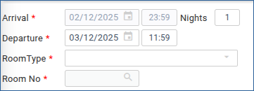
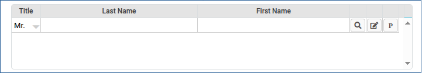
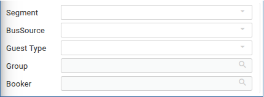
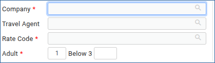
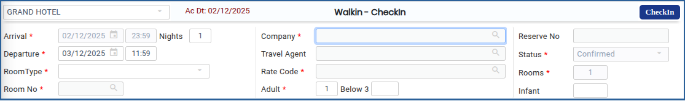
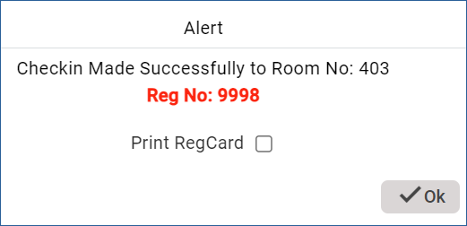

# Walk\_In Check\_In

1.Go to **Reservation Main Menu.**

2.Click on **Walk In Check-In.**

3.Choose a **Room type, No.of Nights, Adults, Rate type,** and **select Room No.**

<figure><figcaption></figcaption></figure>

4\. Type the **Guest name** in case of a new guest or select from an existing guest profile in case of a repeat guest.

<figure><figcaption></figcaption></figure>

5\. If required choose Guest type, Guest status, Reserve Mode, Billing instruction, Payment Mode, Business Source. This will be helpful for hotel analytical reports.

<figure><figcaption></figcaption></figure>

<figure><figcaption></figcaption></figure>

6\. Click **CheckIn** as shown below to complete the process.

<figure><figcaption></figcaption></figure>

Once **Walk-In** check in is completed the **Pop up** will appear as shown below.

<figure><figcaption></figcaption></figure>

