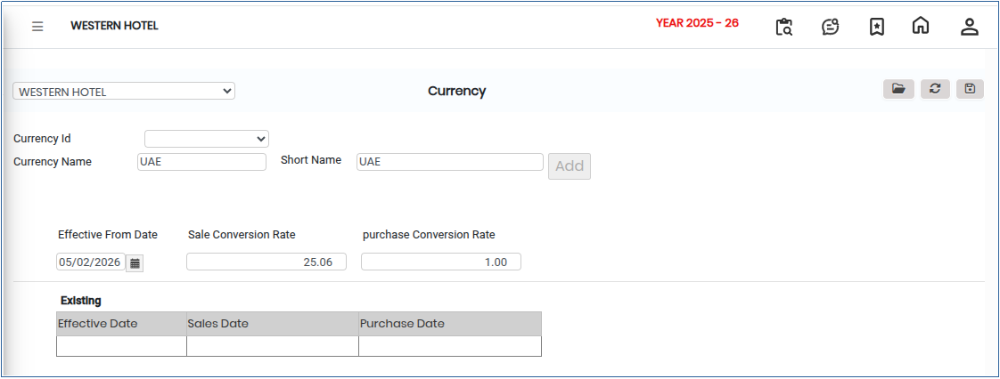

# Currency

**Currency** in an accounting or financial system refers to a standardized unit of money used to record, report, and manage financial transactions. Each currency is identified by specific attributes that enable the system to handle both domestic and foreign currency transactions accurately, including currency conversion for sales, purchases, and reporting.

## Steps to Configure Currency

Step 1: Navigate to the **General Ledger** module.

1. Click **Masters 1** from the menu.
2. Select **Currency** from the list.

* The Currency configuration screen will be displayed.

Step 2: Click on the **Open** button.

1. Select the required **Currency ID** and **Currency Name**
2. Choose the appropriate currency based on user or business requirements.

<figure><figcaption></figcaption></figure>

Step 3: After completing the configuration, click the **Save** button.

* The selected currency and conversion settings will be updated in the system.
